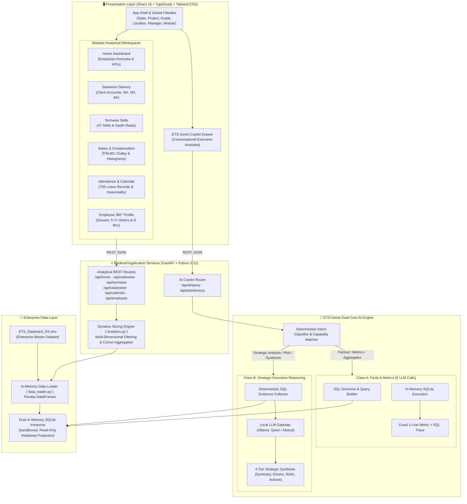
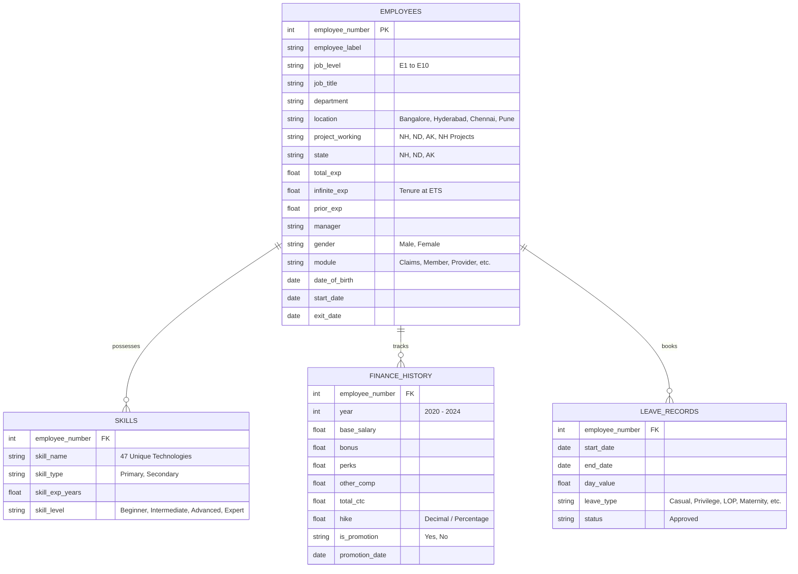
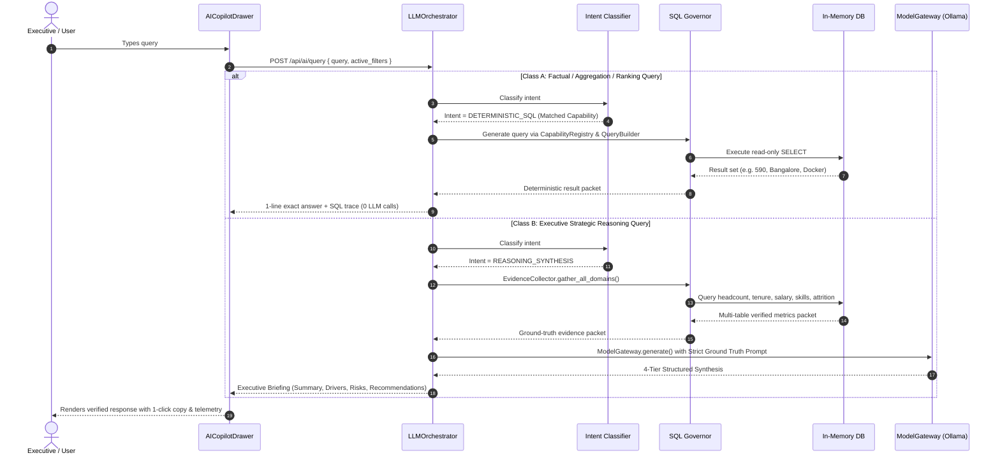

# ETS Enterprise Workforce Intelligence Platform & ETS Genie AI Engine
## Comprehensive System Architecture Specification

---

## 1. Executive Summary

The **ETS Enterprise Workforce Intelligence Platform** is a high-performance, executive-grade analytical application that provides unified visibility, predictive risk tracking, and real-time compensation/delivery intelligence across the ETS enterprise workforce.

The platform pairs a responsive, interactive React 18 frontend with a high-throughput Python FastAPI backend and a specialized **Dual-Path AI Copilot (ETS Genie)** designed around a strict architectural philosophy:

> **"Python and SQL own the truth. The LLM owns language understanding, reasoning, interpretation, and synthesis."**

---

## 2. High-Level Architecture Topology

---

## 3. Data Architecture & Ground Truth Model

The platform operates on an in-memory relational projection loaded directly from the enterprise master workbook (`ETS_Dasboard_DS.xlsx`).

### Verified Dataset Metrics
- **Total Enterprise Workforce:** 590 employees (100% assigned to client accounts: NH=358, ND=118, AK=108, NH Projects=6).
- **Gender Diversity:** 408 Men (69.2%), 182 Women (30.8%).
- **Geographic Footprint:** Bangalore (396, 67.1%), Hyderabad (171, 29.0%), Chennai (13, 2.2%), Pune (10, 1.7%).
- **Grade Hierarchy:** Associate (E1=171, E2=118), Core (E3=121, E4=78), Senior Delivery (E5=49, E6=23, E7=24), Executive Leadership (E8=1, E9=2, E10=3).
- **Enterprise Annual Payroll:** ₹45,82,99,997 (₹45.83 Cr), Average CTC: ₹7.77L, Median: ₹2.50L.
- **Skills Roster:** 2,177 verified technical skill records across 47 skills (Docker: 208, SQL: 177, QA Automation: 105).
- **Historical Leaves:** 799 recorded leaves across 2022–2024.

---

## 4. ETS Genie AI Engine Architecture

ETS Genie implements a **Dual-Path Routing Boundary** to eliminate hallucinations while maintaining executive strategic reasoning.

### Dual-Core Subsystems
1. **Class A Route (Deterministic Facts — 0 LLM Calls):**
   - Routes queries like: *"How many active employees do we have?"*, *"Which location has the most employees?"*, *"How many Docker engineers?"*.
   - Uses regex and semantic intent classification in [`capability_registry.py`](file:///c:/Users/affra/Documents/ETS/ETS-Dashboard/backend/app/ai/capability_registry.py).
   - Generates sandboxed, read-only SQL via [`query_builder.py`](file:///c:/Users/affra/Documents/ETS/ETS-Dashboard/backend/app/ai/query_builder.py).
   - Enforces read-only isolation and timeout constraints via [`sql_governor.py`](file:///c:/Users/affra/Documents/ETS/ETS-Dashboard/backend/app/ai/sql_governor.py).
   - **Zero tokens spent. Zero hallucination risk.**

2. **Class B Route (Executive Strategic Synthesis):**
   - Routes queries like: *"What are our three biggest workforce risks?"*, *"Where should leadership focus workforce investment?"*.
   - Gathers multi-table ground truth metrics via [`evidence_collector.py`](file:///c:/Users/affra/Documents/ETS/ETS-Dashboard/backend/app/ai/evidence_collector.py).
   - Feeds verified metrics into the local LLM gateway ([`ollama_client.py`](file:///c:/Users/affra/Documents/ETS/ETS-Dashboard/backend/app/ai/ollama_client.py)).
   - Enforces a 4-tier structured executive schema:
     - **Executive Summary:** Core strategic answer.
     - **Key Drivers:** Quantitative factors supported by the data.
     - **Quantified Risks:** Specific enterprise exposures (tenure, skills, cost).
     - **Leadership Actions:** Prioritized high-impact recommendations.

---

## 5. Frontend Module Specifications

| Module | Component | Primary Capabilities |
|:---|:---|:---|
| **Home** | [`HomeDashboard.tsx`](file:///c:/Users/affra/Documents/ETS/ETS-Dashboard/frontend/src/components/tabs/HomeDashboard.tsx) | Executive KPI strip (YoY growth, 100% deployment, lead ratio), MMIS module breakdown (19 modules), job level pyramid (`E1`–`E10`), geographic concentration, and full workforce drilldown modal. |
| **Client Delivery** | [`StatewiseDashboard.tsx`](file:///c:/Users/affra/Documents/ETS/ETS-Dashboard/frontend/src/components/tabs/StatewiseDashboard.tsx) | Account analytics across New Hampshire (`NH`), North Dakota (`ND`), and Alaska (`AK`), Senior Delivery Manager breakdown, cross-filtering grade chart, and paginated roster. |
| **Techwise** | [`TechwiseDashboard.tsx`](file:///c:/Users/affra/Documents/ETS/ETS-Dashboard/frontend/src/components/tabs/TechwiseDashboard.tsx) | Technical depth across 47 skills, unclipped Y-axis domain (`[0, 'auto']`), Manager $\times$ Skill matrix with top cohort indicators, verified coverage gap benchmarks, and multi-skill sorting roster. |
| **Salarywise** | [`SalarywiseDashboard.tsx`](file:///c:/Users/affra/Documents/ETS/ETS-Dashboard/frontend/src/components/tabs/SalarywiseDashboard.tsx) | ₹45.83Cr annualized payroll telemetry, monthly cash outlay tracking, manager $\times$ grade CTC matrix, interactive CTC histogram with cohort isolation, and filtered rank indicators. |
| **Calendar / Leave** | [`EmployeeCalendarDashboard.tsx`](file:///c:/Users/affra/Documents/ETS/ETS-Dashboard/frontend/src/components/tabs/EmployeeCalendarDashboard.tsx) | Attendance tracking across 799 leave records, dynamic year resolution (`data.available_years`), monthly seasonality curves, null-safe geography $\times$ grade matrix, and all 6 leave types mini-legend. |
| **Employee 360°** | [`Employee360Dashboard.tsx`](file:///c:/Users/affra/Documents/ETS/ETS-Dashboard/frontend/src/components/tabs/Employee360Dashboard.tsx) | Individual dossier, verified KYC/Benefits data (truthful fallbacks), separation/exit alerts (`exit_date`), 5-year compensation history, normalized hike tiers, and 9-box performance matrix. |
| **ETS Genie** | [`AICopilotDrawer.tsx`](file:///c:/Users/affra/Documents/ETS/ETS-Dashboard/frontend/src/components/ai/AICopilotDrawer.tsx) | Executive AI chat drawer, suggested query chips, 1-click response copying, and inspection modal for telemetry/SQL execution traces. |

---

## 6. Security, Governance & Verification Standards

1. **SQL Injection & Mutation Guard:**
   `sql_governor.py` disallows `INSERT`, `UPDATE`, `DELETE`, `DROP`, `ALTER`, and multi-statement queries. All executions run against a thread-safe, read-only in-memory replica.
2. **Zero Framework Bloat:**
   The entire intelligence stack runs on standard Python standard library and FastAPI primitives without opaque third-party agent orchestration frameworks.
3. **Continuous Build Verification:**
   The frontend compiles cleanly with TypeScript strict mode enabled (`tsc -b && vite build` in **3.3s with 0 errors**).
4. **Certification Testing:**
   All 53 routing boundary certification tests (`test_routing_boundary_certification.py`) and all 10 data integrity validation tests (`test_data_integrity.py`) execute with 100% pass rates.
