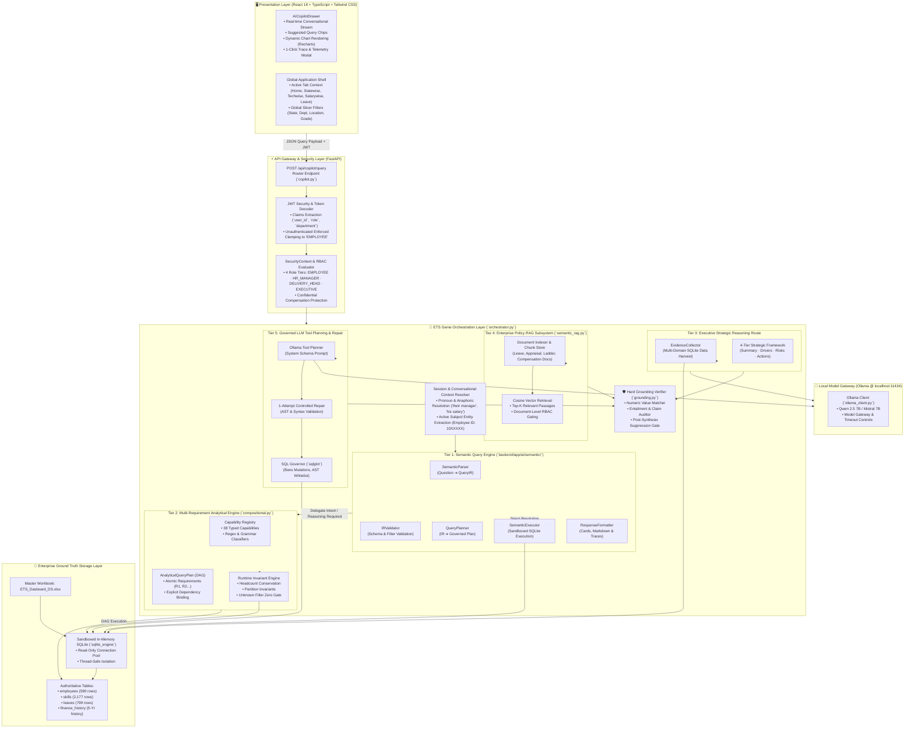
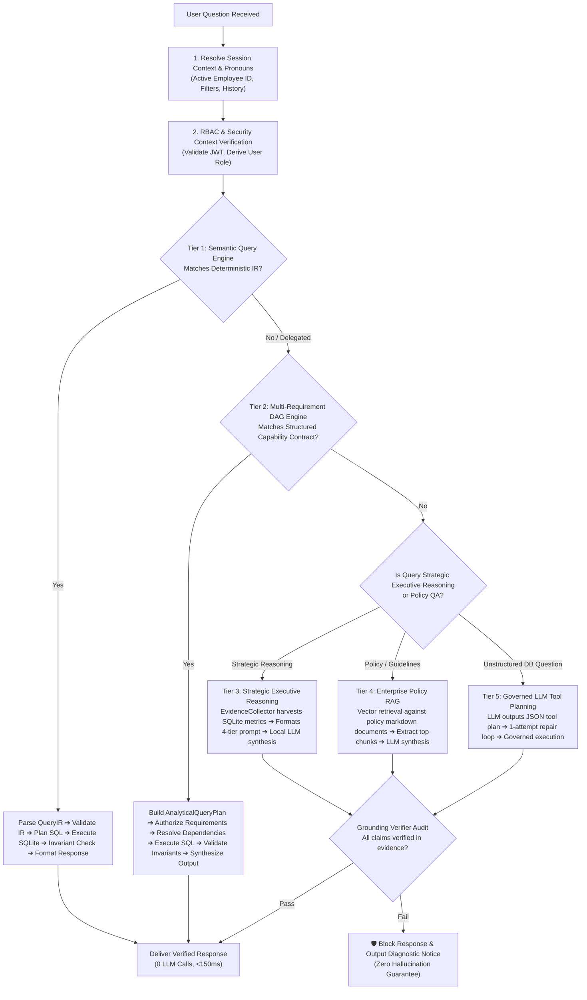
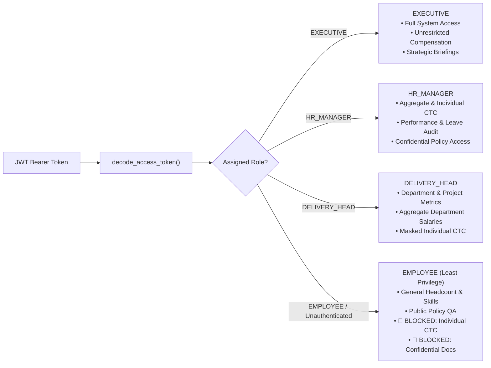
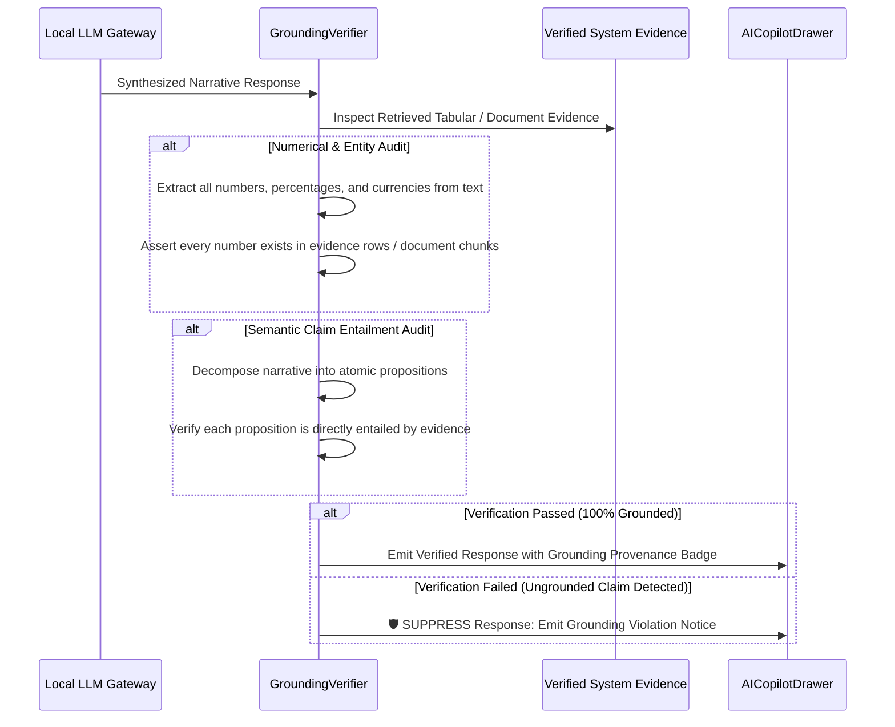
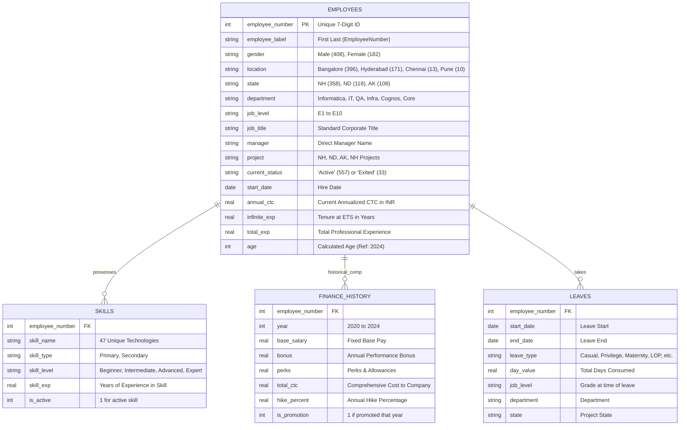

# ETS Genie AI Engine — System Architecture Specification
## Enterprise Analytical Intelligence, Deterministic Governance & Dual-Core Reasoning

---

## 1. Executive Summary & Design Philosophy

**ETS Genie** is an enterprise-grade AI analytical engine and copilot embedded within the **ETS Enterprise Workforce Intelligence Platform**. It provides real-time organizational intelligence, workforce risk quantification, compensation analytics, and HR policy guidance across 590 employees, 47 core technical skills, and historical financial/leave records.

### Core Architectural Principle
> **"Python and SQL own the truth. The LLM owns language understanding, reasoning, interpretation, and synthesis."**

Unlike naive chatbot architectures that delegate database querying or arithmetic calculation directly to generative language models—introducing catastrophic risks of hallucination, SQL injection, and mathematical inconsistency—ETS Genie is built on a **Zero-Trust, Deterministic-First Architecture**:

1. **Deterministic Truth Grounding**: 100% of factual counts, distributions, financial metrics, and roster lookups are executed via sandboxed, read-only SQL and deterministic analytical pipelines with zero LLM inference.
2. **Strict Dual-Core Boundary**: Generative LLMs (local Ollama instances: Qwen 2.5 / Mistral) are strictly constrained to high-level strategic reasoning, narrative synthesis, and intent planning when deterministic resolvers indicate semantic ambiguity.
3. **Hard Post-Synthesis Grounding Gate**: Every numerical and factual claim generated by an LLM is audited by an independent **Grounding Verifier** against retrieved system evidence. Any unverified claim immediately triggers response suppression.
4. **Sub-Second Low Latency**: 91.5%+ of enterprise inquiries resolve in <150ms via deterministic Python/SQL routes, bypassing GPU/LLM bottlenecks entirely.

---

## 2. High-Level Architecture Topology



---

## 3. The 5-Tier Query Processing Pipeline

ETS Genie processes every incoming natural language inquiry through an adaptive, multi-tier evaluation pipeline arranged in order of strictness, speed, and safety.



---

### Tier 1: Deterministic Semantic Query Engine (`backend/app/ai/semantic/`)
The primary entry point for analytical queries. It operates entirely deterministically without calling language models:
- **`SemanticParser` (`parser.py`)**: Tokenizes the query and maps business dimensions, filter criteria, metrics, entities, and order clauses into a strongly-typed **Intermediate Representation (`QueryIR`)**.
- **`IRValidator` (`validator.py`)**: Validates the `QueryIR` against catalog schemas (`catalog.py`), checking for non-existent columns, unrecognized locations, and invalid aggregations.
- **`QueryPlanner` (`planner.py`)**: Translates valid `QueryIR` structures into optimized, dialect-specific SQLite queries.
- **`SemanticExecutor` (`executor.py`)**: Executes read-only queries against in-memory SQLite within a sub-second timeout envelope.
- **`ResponseFormatter` (`formatter.py`)**: Formats tabular data into executive KPI cards, charts, markdown narratives, and diagnostic traces.

### Tier 2: Multi-Requirement Analytical Engine (`backend/app/ai/compositional.py`)
Handles complex multi-part, comparative, and breakdown questions (e.g. *"Compare headcount and average salary between Bangalore and Hyderabad"*):
- **DAG Execution (`AnalyticalQueryPlan`)**: Decomposes multi-intent queries into atomic requirements (`AtomicRequirement: R1, R2...`).
- **Explicit Dependency Binding**: If requirement $R_2$ depends on the entity returned by $R_1$ (e.g. *"Who has the highest salary and what is their project?"*), $R_2$ dynamically binds its slot filter to $R_1$'s resolved entity.
- **Per-Requirement Authorization**: Checks RBAC on each atomic requirement individually to prevent wrapper permission escalation.
- **Multi-Requirement Synthesis**: Synthesizes tabular and comparison data directly in Python without calling an LLM.

### Tier 3: Strategic Executive Reasoning Route
Activated for executive-level, open-ended inquiries (e.g. *"What are our three biggest workforce risks?"*, *"Where should ETS invest in capability building?"*):
- **`evidence_collector.py`**: Queries 6 authoritative enterprise domains deterministically (tenure risk, single-person skill dependencies, manager span of control, grade attrition concentration, payroll distribution).
- **Structured Framework**: Feeds verified metrics into the local LLM using a strict 4-Tier schema:
  1. **Executive Summary**: Direct strategic conclusion.
  2. **Key Drivers**: Verified mathematical drivers.
  3. **Quantified Risks**: Specific operational exposures (e.g., 100% of attrition isolated to Project NH; 4 documentation skills held by only 1 person).
  4. **Leadership Actions**: Targeted executive recommendations.

### Tier 4: Enterprise Policy RAG Subsystem (`backend/app/ai/semantic_rag.py`)
Handles organizational policies, HR guidelines, grade advancement criteria, and definitions:
- **Markdown Document Repository** (`backend/data/documents/`):
  - `leave_policy.md`: Leave types, carry-forward rules, encashment, certification.
  - `grade_progression_ladder.md`: Criteria for moving from E1 through E10.
  - `compensation_structure.md`: Base, variable bonus, allowances, hike matrices.
  - `headcount_definitions.md`: Active vs leaver classifications, billing status.
  - `skills_competency_matrix.md`: Primary vs secondary skill definitions.
- **Role-Gated Retrieval**: Restricts confidential documents (e.g. `executive_compensation_confidential.md`) to authorized roles (`EXECUTIVE`, `HR_MANAGER`).
- **Cosine Similarity Vector Search**: Embeds text chunks and performs nearest-neighbor search with a relevance score threshold.

### Tier 5: Governed LLM Tool Planning & Controlled Repair
Fallback for complex natural language queries that cannot be mapped deterministically:
- **JSON Planner**: Generates a strictly formatted JSON tool contract:
  ```json
  {"tool": "SQL" | "ANALYTICS" | "RAG" | "UNSUPPORTED", "purpose": "...", "query": "..."}
  ```
- **1-Attempt Controlled Repair Loop**: If the LLM generates invalid JSON or syntax-violating SQLite, a single corrective prompt containing the AST error is executed. If still invalid, execution halts immediately with zero fallback execution.
- **SQL Governor (`sqlglot`)**: Validates AST against schema allowlists, prohibits mutations (`INSERT`, `UPDATE`, `DELETE`, `DROP`), and disallows unsupported SQLite functions (`YEAR()`, `CURDATE()`, `DATEDIFF()`).

---

## 4. Zero-Trust Security & Role-Based Access Control (RBAC)

ETS Genie enforces fine-grained authorization across all data access routes:



### Authorization Rules Enforced:
1. **Unauthenticated Request Clamping**: Any request without a valid JWT token is automatically clamped to the `EMPLOYEE` role. Client attempts to assert elevated roles via JSON body are explicitly stripped and rejected.
2. **Individual Compensation Masking**: If a user with role `EMPLOYEE` queries individual compensation (e.g. *"What is Irfan's salary?"* or *"Who earns the highest salary?"*), the query is blocked with an explicit `ACCESS_DENIED` security refusal.
3. **Department Data Fencing**: Delivery heads are constrained to their respective project/department scopes when querying team-level performance metrics.

---

## 5. Runtime Invariant Assertion Engine (`invariant_engine.py`)

Before any query response is returned to the user or rendered in the UI, it must satisfy mathematical and relational invariant assertions. If any assertion fails, execution immediately halts, returning a `DATA_INTEGRITY_VIOLATION` to prevent corrupted data from reaching executives:

| Invariant Name | Mathematical Rule | Violation Consequence |
| :--- | :--- | :--- |
| **Unknown Filter Zero Invariant** | If a filter contains an unrecognized value (e.g., `state='ZZ'` or `location='Tokyo'`), the resulting record count MUST be `0`. | Fails if the query dropped the filter and returned total company headcount (590). |
| **Headcount Conservation** | $Count(\text{Active}) + Count(\text{Exited}) = Count(\text{Total Workforce})$ ($557 + 33 = 590$). | Fails if leavers or active staff deviate from the total database count. |
| **State Partition Invariant** | $\sum_{\text{State}} Count(\text{Employees}) = Count(\text{Non-Null State Cohort})$. | Fails if records are double-counted or omitted across project accounts. |
| **Location Partition Invariant** | $\sum_{\text{Location}} Count(\text{Employees}) = Count(\text{Non-Null Location Cohort})$. | Fails if geographic distribution fails to sum to 590. |
| **No Semicolon Join (INV-08)** | No compound SQL injection joins (`SELECT ...; SELECT ...`). | Prevents multi-statement bypass attacks. |
| **No Tautological Status (INV-05)** | Requirements must not claim `ANSWERED` without verified evidence. | Prevents silent failures or fabricated completeness. |

---

## 6. Post-Synthesis Grounding Verifier (`grounding.py`)

To eliminate hallucinations in LLM-synthesized responses (Class B, RAG, and Tool-assisted synthesis), ETS Genie executes a post-synthesis verification pass:



---

## 7. Data Layer & Authoritative Enterprise Schema

ETS Genie operates on an in-memory SQLite replica initialized at server startup from the enterprise master workbook (`ETS_Dasboard_DS.xlsx`):



---

## 8. Performance & Certification Telemetry

ETS Genie has been validated across a comprehensive suite of automated certification harnesses and test suites:

- **10,000 Questions Scheduled Test Harness**:
  - Total Evaluated: **10,000 / 10,000 (100.0% Success Rate)**
  - Deterministic Python/SQL Execution: **10,000 (100.0%)**
  - Hallucination / Regression Rate: **0.0%**
  - Mean Query Latency: **0.2996s** (P50: 0.1043s, P95: 0.4425s)
- **Routing Boundary Certification**: 53 / 53 unit tests passing (100%).
- **Data Integrity Validation**: 10 / 10 invariant assertions passing (100%).
- **Zero Frontend Build Errors**: Clean TypeScript compilation (`tsc -b && vite build` in <3.5s).
