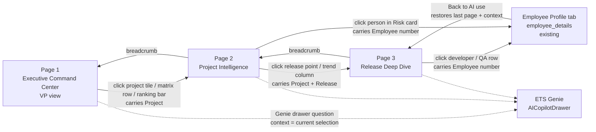

# AI Utilization & Productivity Intelligence Dashboard — Design Package

Design specification for the replacement of the **AI use** tab (`ai_utilization`, `frontend/src/components/tabs/AIUtilizationDashboard.tsx`, fed by `GET /api/ai-utilization/kpis`). Written as a Power BI-grade specification (pages, visuals, DAX, conditional formatting, RLS) and closed with the bridge to the existing React + FastAPI implementation (Section 10). Numbers in worked examples are taken from `templates/Infinite_ETS_India_Workforce.xlsx` as loaded on 2026-11-01: 8 people in the Cognos team, projects NH and AK, releases `2026.10`, `R15.4`, `R15.6`, `R15.7`, one tool (Cursor), Domain `Development` only, 20 activity rows (10 Manual, 10 Estimated), 5 outcome rows, Cursor billing $131.82 for October, 55 hours saved, 124,000 tokens on one row, adoption 7 of 8.

Related documents: `docs/BUSINESS_FLOW.md` (AI utilization), `docs/DATABASE_SCHEMA.md` (AI sheets), `docs/API_DOCUMENTATION.md` (`GET /api/ai-utilization/kpis`).

---

## 0. Decision Intelligence contract (authoritative)

Hierarchy stays **L1 Portfolio Command Center → L2 Project Intelligence → L3 Release Intelligence**. Every screen answers **Situation · Risk · Opportunity · Recommendation**. Progressive disclosure; leadership outcomes over raw tokens / events / users-enabled. VP answers in <15s: what / why / where / value / missed / who / next.

### 0.1 Section map

| Level | Situation | Risk | Opportunity | Recommendation |
| :--- | :--- | :--- | :--- | :--- |
| **L1 Portfolio** | 5 KPI cards (Adoption, Business Value, Hours Saved, Opportunity Loss, Projects Requiring Attention) each with Current · Target · Delta · Trend · Forecast; Portfolio health blocks | Attention Issue Prioritization (impact-framed heatmap/matrix) | Opportunity recovery hero (Potential / Actual / Missed / Missed% / Recovery) + funnel + Adoption × Value quadrant (same row) | Portfolio Narrative (≤3 bullets, full-width bottom) + health tile Recommendation + quadrant action labels (Manager league on Page 2 only) |
| **L2 Project** | Header health/trend + **Top Contributors summary** (View Team expand); Dev vs QA effectiveness battle + DEV/QA/BALANCED; use-case ROI with auto tags; release annotations | Risk count + expandable team | Highest ROI / scale tags; unrealized recovery | Manager formula + one management rec; **QA maturity executive scorecard** (score vs next-level target + capability bars with target tick + blocker + one action); full-height Top-5 league; **Project Recommendation Engine** temporarily removed from Page 2 chrome (will return later as full-width bottom ≤4-action strip) |
| **L3 Release** | Release snapshot + certification (Elite→Critical); contribution matrix; AI release flow | Narrative Key Risks | Benefit waterfall hours+$; recovery in flow coverage | Mandatory 5-bullet narrative + next-release actions |

### 0.2 Live Page 1 contract (Decision Intelligence)

- **KPI row (5):** AI Adoption · Business Value · Hours Saved · Opportunity Loss · **Value at Risk** (chosen over Critical Projects / Critical Risks when unrealized $ is material — live ~$46.6k vs 2 projects / 3 P1). Trend chips use ▲ Improving / ▼ Declining / ▬ Stable (Adoption shows ▼ vs target when below target; Business Value shows ▲ gained when Δ>0).
- **Portfolio health:** adaptive rich/compact; Manager · Health · Hours · Value · Risk · **project trend badge** from `trend_pts` (no invented history) · **one** Recommendation badge: `Executive Review` | `Drive Adoption` | `Scale Best Practices` | `Monitor` | `Improve QA`. Header: `$ / 1K tok` efficiency chips banded green→amber→red (higher `$ Generated / 1K` better) + compact **Worst first / Best first** sort control (default worst).
- **Attention → Issue Prioritization Engine:** Project=heatmap with **Impact $** cells + popover (Priority · Owner · Action); Type=prioritization table (Issue · Business Impact · Priority · Owner · Recommended Action).
- **Opportunity loss:** hero Potential / Actual / **Missed (red)** / **Recovery % + Recovery Value (amber)**; funnel-only body (no duplicate Missed chip in the section header).
- **Quadrant labels (auto-classify):** Strategic Leaders · Growth Candidates · Execution Risk · Turnaround Required. Tooltip: business value + trend.
- **Portfolio Narrative:** deterministic ≤5 bullets — Situation · Opportunity · Risk · Priority · Executive Action; full-width bottom row on Page 1.
- **Manager league:** **removed from Page 1**. Page 2 keeps a **project-scoped Top 5** league (Rank · Manager · Value · Score) with **View Full Ranking** as its own low-row column (Manager | Release | League) — no longer stacked under recommendations.
- **Release Intelligence (Page 2):** **project-scoped only** — chart, chips, best/worst/now callouts, and deltas use `release_trend[]` filtered to the drilled project (fallback: that project's `health.release_series`). Never portfolio-wide. Backend `health.release_series` / `releases_in_scope` also stay project-bound (activity + outcomes with matching `Project`) — shared teams (IT/Core/Cognos) must not pull peer-project releases (e.g. ND `R24.*` into AK/NH). **Info roles (no repeat):** callouts = where we are (Best / Worst / Now; **merge** when Now equals Best or Worst into one tile e.g. `Best · Now`); chart = trend (point labels = adopt % only); chips = release picker (name + `!` anomaly only — adopt lives in callouts/tooltip); insight = one action line **without** restating release names/metrics already on callouts. Card polish: **single-line** head (title + compact `{Project} · N` + Improve/Trend chips; no subtitle row); current-release reference line; **full project-scoped chip row always visible** (compact wrap/scroll on the chip row only — **no More/Less**); Genie clamps insight.
- **Project Recommendation Engine (Page 2) — deferred:** temporarily **removed from Page 2 chrome** (`SHOW_PROJECT_REC_ENGINE = false`); data helpers (`project_recommendations`, `execActions`) and `.ai-p2-narr` styles remain for a later restore as the full-width bottom ≤4-action strip (Page 1 Portfolio Narrative pattern). Live `.ai-p2` grid is **`auto | auto | minmax(0, 1fr)`** (header | content-sized mid | low — no reserved narr row). Mid hugs Battle/UC; QA stretches to that height and scrolls inside the card. Leftover height goes to low (Manager / Release / League).
- **Page 2 mid density (Battle | UC | QA):** CSS/grid only — Battle and UC stay fully visible with **no body scroll** (typical laptop + Genie-closed; Genie-open compact too). **Mid height tracks Battle/UC content** (Battle ~9 metric rows + UC ~8 rows + small pad) — not an `fr` stretch that left empty navy, and not the full QA scorecard. **Grid:** `.ai-p2` rows `auto | auto | minmax(0, 1fr)` (was `auto | minmax(12rem, 1.18fr) | minmax(0, 1fr)`); Genie same mid `auto` with low floor `minmax(12.75rem, 1fr)`. Mid/low column tracks are shared CSS vars on `.ai-p2` (`--ai-p2-col-1/2/3` → `0.56/0.75/1.69`; Genie `0.66/0.84/1.60`) so **Manager width === Battle width** and cannot drift. Battle/UC strips `flex: 0 0 auto` (no empty body growth). **QA maturity** is mid col 3 (the wide track). It stretches to the Battle/UC row (`height: 0; min-height: 100%`) so the scorecard does not force mid much taller than Battle; head stays fixed and `.ai-p2-qa-body` scrolls as a last resort. **Decision-first:** left rail is journey (composite **score vs L{n+1} target**, not /100) plus the **Biggest constraint + One action** decision band; right rail is capability bars (full wrapping labels + target tick; weakest axis highlighted) so the action is not below the fold. Genie stacks journey → decision → bars. Card pad `0.32/0.45/0.28` (Battle horizontal `0.32rem`; UC horizontal `0.28rem`); battle value tracks `minmax(3.25rem, 0.9fr)` so `1,342.2 h` holds — limiter is **Defect Prevention**. UC strip tracks hug headers/`$12,884`/Rec; col 2 is content-tight — limiter is **Knowledge Search + Fastest Growing** (name may ellipsis, tag stays). battle/UC strip gap ≈`0.06`. No More toggles; project scoping / release dedupe unchanged. Leftover viewport height goes to low (Manager | Release | League) — intentional. **Release intelligence** is low col 2 (~0.75fr, narrower than its old col 3). Callouts, chart, and chips are denser (tighter pad/type; callout labels wrap instead of ellipsis) so they fit that column. Chart floor ≈`2.6rem` (Genie ≈`2.2rem`) and the chart fills leftover low-row height. Release body scrolls (`overflow-y: auto`) if the low row is shorter than callouts + chart + chips — same pattern as League.
- **Page 2 Manager score (low col 1 only):** Compact `.ai-p2-mgr` card pad; dense 2×2 tiles (BAND left accent + clearer inset meter + weight secondary / score primary); tiles content-hug; recommendation 2-line clamp; **`overflow-y: hidden` on normal laptop** (Genie `@container` ≤1180px may `auto` as last resort). Release (low col 2) and League scroll when their bodies exceed the low row; column vars unchanged.
- **Page 2 executive polish (no layout redesign):** Header is **exactly two lines** — (1) crumb · ring · project · band · trend · rec; (2) Manager/Team/Value/Unrealized/risks + `Contributors N` · $ · View Team. **Dense head chrome** (`.ai-p2-head`): padding ≈`0.12rem` / row gap ≈`0.04rem` / ring 26px / meta ≥10px — reclaim height into mid/low via `grid-template-rows: auto …`. Battle card: **single-line** head (title + DEV LEADING / QA LEADING / BALANCED / QA GAP chip; no “Effectiveness — not just activity” subtitle); aligned Dev | metric | QA compare; **full metric list always visible** (effectiveness rows + n/a extras) — **no More/Less**; dense row spacing (avoid inner scroll). **Use case effectiveness:** **single-line** head (title only; no “What to scale · top N by Value” subtitle); full ranked strip always visible — `# · Use case (+tag) · Usage · Hours · Trend · Value · Rec` + thin CSS value bar (active-by-Value first, then zero-usage / n/a) — **no More/Less**; dense row spacing; Genie drops Trend so Rec fits (avoid inner scroll). No Usage/Hours heat wash. Tags (Highest ROI, Fastest Growing, …) and Rec (Scale/Monitor/…) kept; one chip/BAND language. **Release intelligence:** **single-line** head (title + `{Project} · N` + Improve/Trend chips; no subtitle); Best / Worst / Now callouts **merged when roles share a release**; chart point labels = adopt %; chips = name (+ `!`) picker only; insight = action without name/metric echo; `!` only for true anomalies (missing evidence or ≥15pt health drop); **full project-scoped chip row always visible** (wrap/scroll chips only — **no More/Less**); compact chart/callouts/chips densified for **low col 2** (~0.75fr; callout labels wrap, chart/chip type tightened, body scrolls if the low row is short). **Manager score:** **single-line** head (title + name + grade/score chip; formula weights on tiles only — no subtitle row); dense **2×2** tiles (BAND left accent · label + weight · prominent score · clearer Manager-scoped meter; content-hug); one calm Recommendation (2-line clamp + `title`); **`overflow-y: hidden`** on normal laptop (Genie may `auto`). Width locked to Battle via shared `--ai-p2-col-*`. **QA maturity:** executive scorecard (radar retired) — title **QA maturity** + **Current: L{n} label → Next: L{n+1} label**; On Track / Watch / At Risk chip; composite score shown as **{avg} vs {target}** (`avg(maturity_radar.axes)` on a 0–100 track with an L3≈70 / L4≈80 / L5≈90 tick) plus readiness % and gap; horizontal capability bars sorted **weakest-first** (QA_AXIS_ALIAS labels wrap, never ellipsis mid-word; same BAND fills; target tick; weakest row highlighted); Biggest constraint (lowest axis · current → target · gap · impact) and **One action** (from `project_recommendations.bullets` or weakest-axis action + Expected Gain / Priority / Impact chips) sit together in a decision band. Executive narrative is the `title` on that band (not a third below-fold paragraph). Wide layout is **journey + decision | bars**; Genie stacks **journey → decision → bars**. **QA maturity** sits in **mid col 3** (wide track): head fixed; body may scroll if Battle/UC height is tight. **Low row (Manager | Release | League):** cols match mid (`0.56/0.75/1.69`; Genie `0.66/0.84/1.60`) so Manager aligns under Battle and Release sits in the narrower col 2. Card head/title stays fixed; Manager densifies to fit without scroll when possible; Release/League bodies remain shrinkable flex children (`min-height: 0`) with `overflow-y: auto` + thin `custom-scrollbar` when content exceeds low-row height — Genie-open included; no More toggles on Manager/QA/Release. League keeps Top-5 + View Full Ranking with the same body scroll. Validate Normal/FS × Genie open/closed before sign-off.
- **Page 2 visual craft (calmer chrome):** Earlier purpose rainbow left-borders / soft washes / multi-variant chips (`ai-chip-quiet` / status / tags / rec-pills) were dialed back. Cards are plain `glass-panel` + shared title strip; status language is one system (`ai-chip` + BAND green/amber/red/neutral). Header stays two dense lines with clear project name and compact contributor text (not chip soup); vertical padding/gap kept minimal so mid/low cards grow. Battle / use-case / release / manager / QA / league keep the same information; QA uses the maturity scorecard (no spider chart); **bottom Project Recommendation Engine strip is deferred** (not rendered; grid has no narr row). **Genie-docked (`@container` ≤1180px):** mid stays true **3-col** (Battle | UC | QA) — prior 2+1 stamped Battle/UC at ~134px; cols `0.66fr 0.84fr 1.60fr` (Battle narrower than UC/QA, a bit wider than the Genie-closed `0.56fr`); mid row stays content-`auto` (same hug as Genie-closed). Battle / UC show full lists at compact density (no More); QA scrolls inside that height; UC Trend hides under Genie so Rec stays; **low 3-col uses the same Genie fractions** (Manager | Release | League, Manager under Battle) with denser Manager tile/meter pad + height floor and denser Release callouts/chips for col 2. Fullscreen rules unchanged.

### 0.3 Scoring / formula notes (interim)

| Artifact | Formula |
| :--- | :--- |
| Health 0–100 | §3.2 weights C1–C5; N/A renormalise |
| Opportunity Loss $ | `max(0, Potential Value − Actual Value)`; Missed% = Loss ÷ Potential |
| Recovery Potential | Missed $ (same as unrealized until recovery actions tracked) |
| KPI Forecast | `Current + Δ vs prior release` when prior exists; else `n/a` |
| Health Recommendation | Elite/Strong + rising → `Scale Best Practices`; High adopt / low value → `Monitor`; Low adopt / high value → `Drive Adoption`; QA gap mid-band → `Improve QA`; Health <70 or crowded risks → `Executive Review` |
| Quadrant | X=Adoption vs target; Y=Value vs portfolio median — Strategic Leaders (HH), Execution Risk (HL), Growth Candidates (LH), Turnaround Required (LL) |
| Manager Effectiveness | Adoption 30 · Savings 25 · Efficiency 20 · Evidence/Quality 25 → 100-pt; grades A+…D (§3.5). Component breakdown exposed on Page 2. |
| Release Certification | Elite ≥90 · Strong 80–89 · Certified 70–79 · At Risk 60–69 · Critical <60 (project health at release) |

### 0.4 Gaps vs full brief (honest backlog)

| Item | Status |
| :--- | :--- |
| True multi-period forecast model | Interim linear Δ; no seasonality |
| Attention Est. Value Lost per rule | Derived from project unrealized × severity weight; not activity-level $ |
| Opportunity Recovery Tracker history | Recovery Potential = current Missed $ until action log exists |
| LLM Portfolio / Release narrative | Deterministic rules only |
| Page 2 use-case ROI rank polish / Page 3 stories·defects | Still blocked on intake columns (§10.3) |
| Genie / fullscreen / ~3.25-line KPIs / adaptive health | Preserved |

---

## 0b. Executive summary (history)

The original tab failed the 10-second rule because it was organised by **data source** instead of by **decision**. The Decision Intelligence redesign is three pages with one drill path. **Page 1** is the Portfolio Command Center (5 leadership KPIs including Opportunity Loss, worst-first health with recommendations, impact-framed Attention, Opportunity recovery + funnel beside Adoption × Value quadrant, full-width ≤3-bullet Portfolio Narrative at the bottom — no Manager league). **Page 2** answers "why is this project where it is?" (header recommendation, Dev vs QA Battle Card, use-case matrix, release timeline, manager scorecard + league, QA maturity executive scorecard; full-width ≤4-action Project Recommendation Engine strip temporarily deferred). **Page 3** answers "what did AI deliver in this release?" (snapshot + certification, contribution matrix, release-flow, benefit waterfall, mandatory five-bullet narrative).


Design principles (restated from the brief):

1. **Decision first** — every visual answers one business question stated in its title.
2. **10-second rule** — status, direction, and magnitude are visible without reading.
3. **Exception-only attention** — alerts render only when a rule fires; silence is a result.
4. **Traffic-light discipline** — one colour vocabulary (Green/Amber/Red/Neutral/Info) with fixed thresholds from a Targets table, never ad hoc.
5. **Targets, not totals** — every KPI shows value, target, and variance.
6. **Drill, do not scroll** — VP → Project → Release → Person; each page fits one 16:9 canvas.
7. **Compare, do not list** — Dev vs QA, this release vs previous, project vs project.
8. **Composite scores with transparent formulas** — Health, Maturity, ROI, Manager Effectiveness.
9. **Honest evidence** — Estimated vs Manual vs Export is surfaced as a confidence badge; gaps are named.
10. **Consistency with the existing dashboard** — glass cards, `.dash-fit` pane-fit, cyan/teal accents, mono numerics, 260px Genie drawer tolerated.

---

## 1. Information architecture & navigation flow

### 1.1 Pages

| Page | Audience | Question answered | Grain |
| :--- | :--- | :--- | :--- |
| **Page 1 — Executive Command Center** | VP / Executive Leadership | Where is AI paying off, where is it not, where must I intervene? | Portfolio → Project |
| **Page 2 — Project Intelligence** | SDM, QA Manager, Delivery Head | Why is this project Green/Amber/Red and what do I change next release? | Project → Domain → Release |
| **Page 3 — Release Deep Dive** | SDM, QA Manager, Release Owner | What exactly did AI deliver in this release, by whom, and what is the realised benefit? | Release → Person |

### 1.2 Drill path



Text form of the same path:

```text
VP (Page 1)  ──project──▶  Project (Page 2)  ──release──▶  Release (Page 3)  ──person──▶  Employee Profile
   ▲                              ▲                                 ▲                          │
   └──────── breadcrumb ──────────┴──────────── breadcrumb ─────────┴──────── Back ────────────┘
```

### 1.3 Breadcrumb and context header rules

- Breadcrumb sits on the first line of every drilled page, left-aligned, 11px, in the existing `glass-panel` header strip: `AI use › NH › 2026.10`. Each earlier segment is a button that navigates back and prunes deeper context (`AI use` → Page 1 portfolio; project → Page 2). Page 2/3 keep the chevron back control as a second affordance.
- **Persistence**: `project` and `release` persist in `AIUtilizationDashboard` component state for the session. When FilterBar `project` (or `release` on Page 3) changes to a set that excludes the drilled value, page context resets (portfolio / project) so the UI does not leave a stale drill.
- Page 1 ignores a persisted `release` for the KPI row (portfolio totals are "latest release per project") but honours FilterBar `release` in the API slice.
- Page 3 requires both `project` and `release`; if `release` is absent it defaults to the latest `Release_Sequence` for that project.
- Dynamic page titles come from `[Dynamic Title]` (Section 7) so the title restates the slice: `NH · AI Health 90 · Green`.
- **FilterBar (AI use tab):** Project + Release + Manager are live. Manager is applied in `get_ai_utilization_kpis` against `AI utilization.Manager` and `AI release outcomes.Owner` (FilterBar values may include `Name (emp#)`; matching strips the id). **Dept and Module are hidden** on this tab — those columns exist only on People, not on the AI sheets, and Module (MMIS Claims/Member/…) is not Domain (Development/QA). Do not invent a People join for Dept/Module. Domain remains an API filter key when passed explicitly; it is not shown as a Module alias.
- Portfolio quadrant scatter dots are clickable (same `openProject` path as the legend chips); tooltips stay on hover. Page 2 risk chips with `employee_number` open Profile via `onSelectEmployee`. Page 3 contribution rows open Profile on single-click / Enter / Space (Work model roster pattern); rows without an employee number stay non-interactive with the design tooltip.

---

## 2. Color palette & executive theme

### 2.1 Semantic tokens

All values are Tailwind 3.4 palette steps already present in `frontend/src/index.css` usage (cyan/sky/teal/amber/rose/emerald/slate), so no new colour families are introduced.

| Token | Light theme fill | Light text-on-fill | Dark theme fill | Dark text-on-fill | Solid accent (bars, icons, rings) | Use |
| :--- | :--- | :--- | :--- | :--- | :--- | :--- |
| **Green** | `#ecfdf5` (emerald-50) | `#064e3b` (emerald-900) | `rgba(5,150,105,0.18)` | `#6ee7b7` (emerald-300) | `#047857` (emerald-700) light / `#34d399` (emerald-400) dark | On or above target |
| **Amber** | `#fffbeb` (amber-50) | `#78350f` (amber-900) | `rgba(217,119,6,0.18)` | `#fcd34d` (amber-300) | `#b45309` (amber-700) light / `#fbbf24` (amber-400) dark | Within tolerance below target |
| **Red** | `#fff1f2` (rose-50) | `#881337` (rose-900) | `rgba(225,29,72,0.18)` | `#fda4af` (rose-300) | `#be123c` (rose-700) light / `#fb7185` (rose-400) dark | Below tolerance; exception |
| **Neutral** | `#f1f5f9` (slate-100) | `#334155` (slate-700) | `rgba(100,116,139,0.18)` | `#cbd5e1` (slate-300) | `#64748b` (slate-500) | No target / not applicable / blank |
| **Info** | `#ecfeff` (cyan-50) | `#164e63` (cyan-900) | `rgba(2,132,199,0.18)` | `#7dd3fc` (sky-300) | `#0284c7` (sky-600) / `#0d9488` (teal-600) for the second series | Informational, selection, Dev (sky) vs QA (teal) |

Rules:

- **Whole-tile recolour** (Section 4.3) uses the *fill* column plus a 4px left border in the *solid accent*. Text uses the *text-on-fill* column. Every pair above is ≥ 4.5:1 (WCAG AA, normal text) in both themes; the 700-step solids on white and the 300/400-step solids on slate-900 `#0f172a` are ≥ 4.5:1 for 10–12px bold labels.
- **Never encode by colour alone.** Each coloured tile or cell also carries an icon (▲ up / ● on track / ▼ down) or the word (Green/Amber/Red) in the tooltip. Icon set: `lucide-react` `TrendingUp`, `Minus`, `TrendingDown`, `AlertTriangle`.
- Dev vs QA series colours are fixed: Development `#0284c7` (sky-600), QA `#0d9488` (teal-600), matching the current domain mix card.

### 2.2 Gradients

| Gradient | Stops | Where |
| :--- | :--- | :--- |
| Sequential heatmap (intensity) | `rgba(2,132,199,0.08)` → `rgba(2,132,199,0.63)` (same as current Team × Project matrix) | Hours, tokens, counts in matrices |
| Diverging (variance / delta) | `#be123c` (−) → `#e2e8f0` slate-200 (0) → `#047857` (+) | Δ vs previous release, variance to target |
| Data bar positive | `#0ea5e9` (sky-500) at 85% opacity, 2px radius | Hours Saved, Adoption, ROI, Coverage |
| Data bar negative | `#fb7185` (rose-400) | Negative Δ only |
| Ring track / fill | track `rgba(148,163,184,0.25)`, fill = semantic solid of the band | Project AI Score ring, Adoption ring |

### 2.3 Typography and spacing (matches existing glass cards)

| Element | Spec |
| :--- | :--- |
| Card title | 12px, `font-bold`, `tracking-tight`, slate-800 / slate-200 |
| Card hint (right of title) | 10px, `font-mono`, slate-500 / slate-400 |
| KPI label | 9.5–10px, `font-bold`, uppercase, `tracking-[0.06em]`, `var(--muted)` |
| KPI value | ~15.7px / `0.98rem` (`.ai-kpi-value`), `font-black`, `font-mono`, `tracking-tight` (kept larger than tgt/fc ~10px; reduced further so strip stays calm) |
| KPI card layout | **~3–3.25 lines**: (1) icon · title · delta chip; (2) `Current` label + dominant value; (3) band icon + Target/gap/forecast. Strip `max-height` ≈ 4.35rem for executive laptop readability |
| KPI target / variance line | 9.5px `font-mono` on line 3; muted vs dominant value; variance coloured by band |
| Table numerics | 11px `font-mono`, right-aligned, thousands separator |
| Narrative sentences | 10.5px, ≤3 bullets full-width bottom (Situation · Risk/Opportunity · Next) |
| Card | `glass-panel rounded-xl p-2.5 shadow-2xs`; grid gap `0.45rem`; min card height 6.5rem |
| Borders | `border-l-4` semantic accent on tiles and alerts; `border-t-2` accent on KPI cards (existing) |

### 2.4 Power BI theme JSON

```json
{
  "name": "ETS AI Utilization Executive",
  "dataColors": ["#0284c7", "#0d9488", "#047857", "#b45309", "#be123c", "#7c3aed", "#64748b", "#0ea5e9"],
  "good": "#047857",
  "neutral": "#b45309",
  "bad": "#be123c",
  "maximum": "#047857",
  "center": "#e2e8f0",
  "minimum": "#be123c",
  "null": "#94a3b8",
  "background": "#ffffff",
  "secondaryBackground": "#f8fafc",
  "foreground": "#0f172a",
  "foregroundNeutralSecondary": "#475569",
  "foregroundNeutralTertiary": "#94a3b8",
  "tableAccent": "#0284c7",
  "hyperlink": "#0284c7",
  "visualStyles": {
    "*": {
      "*": {
        "title": [{ "fontSize": 10, "fontFamily": "Segoe UI Semibold", "fontColor": "#1e293b" }],
        "background": [{ "color": { "solid": { "color": "#ffffff" } }, "transparency": 6 }],
        "border": [{ "show": true, "color": { "solid": { "color": "#e2e8f0" } }, "radius": 12 }]
      }
    },
    "card": { "*": { "labels": [{ "fontSize": 20, "fontFamily": "Consolas", "color": { "solid": { "color": "#0f172a" } } }], "categoryLabels": [{ "fontSize": 9, "color": { "solid": { "color": "#64748b" } } }] } },
    "tableEx": { "*": { "grid": [{ "gridVertical": false, "gridHorizontalColor": { "solid": { "color": "#f1f5f9" } }, "rowPadding": 2, "textSize": 9 }] } },
    "pivotTable": { "*": { "grid": [{ "gridVertical": false, "rowPadding": 2, "textSize": 9 }], "subTotals": [{ "rowSubtotals": false }] } }
  }
}
```

A dark variant swaps `background` `#0f172a`, `secondaryBackground` `#1e293b`, `foreground` `#f8fafc`, and the solid accents to the 300/400 steps listed in 2.1.

---

## 3. Scoring models

All targets and weights live in a **Targets** parameter table (`AI targets` sheet proposed in Section 10; `Targets` table in the Power BI model). Nothing below is hard-coded in a visual.

### 3.1 Target & tolerance rule (applies to every banded measure)

| Band | Rule (higher-is-better metric) | Rule (lower-is-better metric, e.g. Tokens per Hour Saved) |
| :--- | :--- | :--- |
| **Green** | `Actual ≥ Target` | `Actual ≤ Target` |
| **Amber** | `Target × 0.90 ≤ Actual < Target` | `Target < Actual ≤ Target × 1.10` |
| **Red** | `Actual < Target × 0.90` | `Actual > Target × 1.10` |
| **Neutral** | Target blank, or denominator = 0 (shown as "n/a", never as 0%) | same |

Tolerance (10%) is a column on Targets so a metric can override it.

### 3.2 Project AI Health Score (0–100)

Replaces the previous C1–C7 mix (Dev adoption, hours/user, cost efficiency, trend). Leadership weights **opportunity and QA**, not token volume.

Component scores are each normalised to 0–100 as `MIN(100, Actual ÷ Target × 100)` unless noted, then weighted.

| # | Component | Weight | Actual | Target (default) | Normalisation note |
| :--- | :--- | :--- | :--- | :--- | :--- |
| C1 | **Adoption %** | 30 | Active users ÷ Headcount in scope | 80% | Active user = ≥ 1 activity row with `Hours_Saved > 0` or `Total_Tokens > 0` in the current release |
| C2 | **Business Value (vs target)** | 25 | Hours Saved × `Loaded_Rate_USD` ($40/h) | Potential Value = headcount × target hours/user × rate (8 h × $40) | Score = Actual Value ÷ Potential Value × 100, capped at 100 |
| C3 | **Release Coverage %** | 20 | Releases with quantified AI evidence ÷ releases in scope | 100% | Quantified evidence = ≥ 1 row with hours > 0 or tokens > 0 |
| C4 | **QA Adoption %** | 15 | Same as C1, Domain = QA | 50% | **N/A** when the project has no QA outcome row → weight redistributed. Zero users with a QA row = 0 (penalised) |
| C5 | **Documentation Usage** | 10 | Docs use-case hours | 10% of potential hours (or `Docs_Usage_Pct` of headcount when potential is missing) | Zero docs hours scores 0, not N/A |

**Formula**

```text
Health = Σ_i (w_i × score_i)  over components that are not N/A
         ÷ Σ_i w_i            over the same components
```

N/A components drop out and remaining weights renormalise. A project is never penalised for a dimension it cannot have (no QA headcount), but *is* penalised for a dimension it has and misses (QA row with zero users → C4 = 0; hours exist but no Docs rows → C5 = 0).

**Leadership bands** (badge on the tile): **90–100 Elite** | **80–89 Strong** | **70–79 Average** | **<70 Attention Required**.

**Tile colours** (user spec): **Green Health > 80** | **Amber 60–80** | **Red < 60**. When 60–70 is both Amber tile and Attention Required band, show Amber tile + **Attention** badge.

**Opportunity loss** (portfolio and per project)

```text
Potential Hours = headcount_in_scope × target hours/user (AI targets, default 8h)
Potential Value = Potential Hours × Loaded_Rate_USD
Actual Value    = Hours Saved × Loaded_Rate_USD
Unrealized      = max(0, Potential − Actual)
```

**Token efficiency** (leadership, never raw tokens on Page 1 KPI row): `$ Generated per 1K tokens` = `(Hours Saved × rate) / (tokens / 1000)`. Zero tokens → `null`.

**Worked snapshot (roster-scale workbook, 2026-11-01 reload):** NH **86.9 Strong / Green**; ND **75.5 Average / Amber**; AK **66.3 Attention Required / Amber + Attention badge**. Portfolio health **82.6 Strong**. Opportunity: Potential **$176,640** (4,416 h) · Actual **$136,828** (3,420.7 h) · Unrealized **$39,812**.

**Evidence Confidence badge** (shown beside every Health Score, not part of it): share of hours saved whose `Source` is `Export` or `Manual`. NH: 7 of 53 h (13%) non-Estimated → **Low confidence**. Thresholds: High ≥ 80%, Medium 50–79%, Low < 50%. This keeps the score honest without punishing a team for reporting estimates while the Cursor export is not wired.

### 3.3 AI Maturity Score (Level 1–5)

Assessed per project per release; the highest level whose criteria are **all** met.

| Level | Name | Criteria (all required) | Cognos / NH today |
| :--- | :--- | :--- | :--- |
| 1 | Ad-hoc | Any activity row exists | ✓ |
| 2 | Emerging | Adoption ≥ 50%; ≥ 1 approved tool from `AI tools catalog`; outcome row Submitted | ✓ (87.5%, Cursor, Submitted) |
| 3 | Defined | Adoption ≥ 70%; ≥ 3 distinct Lists use cases with hours; Evidence Confidence ≥ Medium; QA domain has ≥ 1 row | ✗ (confidence Low, no QA row) |
| 4 | Managed | Release coverage 100%; token data from `Export` for ≥ 80% of active users; Dev and QA adoption both ≥ target; ROI Index ≥ 5 | ✗ |
| 5 | Optimized | Level 4 for 3 consecutive releases; adoption trend ≥ 0 for 3 releases; Manager Grade ≥ A; defects reduced recorded | ✗ |

Result today: **Level 2 — Emerging**. Displayed as a 5-segment stepper on Page 2 header.

### 3.4 AI ROI Index

```text
Est Cost Savings = Hours Saved × Loaded Rate
AI ROI Index     = (Est Cost Savings − Tool Spend) ÷ Tool Spend
```

- `Loaded Rate` is a parameter in Targets (`Loaded_Rate_USD`, default **$40/h**; `Loaded_Rate_INR` default ₹3,000/h with `Display_Currency` toggle). The VP can change it in the Targets sheet; nothing else changes.
- `Tool Spend` = Σ `Cursor billing.Cost_USD` for billing cycles overlapping the release window (allocated by name/employee number to the project in the billing row; unallocated spend is reported in a Neutral "Unallocated" row, never silently dropped).
- Worked example (portfolio, October): 55 h × $40 = **$2,200** savings; spend $131.82; ROI Index = (2,200 − 131.82) ÷ 131.82 = **15.7×**. Target 5×; Amber 4.5–5×; Red < 4.5×.
- Displayed as `15.7×` with the savings figure in the sub-line; tooltip shows the rate used.

### 3.5 Manager AI Effectiveness Score

Per Manager (`AI utilization.Manager` = `AI release outcomes.Owner`), per release.

| Component | Weight | Actual | Target | Note |
| :--- | :--- | :--- | :--- | :--- |
| Adoption | 30 | Active users ÷ headcount in the manager's rows | 80% | |
| Savings vs target | 25 | Hours saved ÷ (Target hours per user × headcount) | 8 h × headcount | |
| Efficiency gain | 20 | Hours saved ÷ Baseline hours (rows with baseline) | 30% | Only rows with `Baseline_Hours > 0` |
| Release quality / evidence | 25 | Until defects are captured: share of rows that are quantified **and** non-Estimated. After Phase 3: 50% defects-reduced vs target + 50% evidence | 80% | Swaps automatically when `Defects_Reduced` is populated |

Grades: **A+** ≥ 90, **A** 80–89, **B** 70–79, **C** 60–69, **D** < 60.

Worked example — Cognos SDM, release 2026.10: Adoption 87.5% → 100 × 0.30 = 30.0; Savings 55 h ÷ 64 h = 85.9 × 0.25 = 21.5; Efficiency gain 50 h ÷ 121 baseline h = 41.3% vs 30% → 100 × 0.20 = 20.0; Evidence 3 of 20 rows quantified Manual = 15% vs 80% → 18.75 × 0.25 = 4.7. **Score 76.2 → Grade B.** The scorecard sub-line reads "Evidence quality is the gap: 10 Estimated rows, 7 rows without hours."

---

## 4. PAGE 1 — Executive Command Center (VP view)

Business question: **Where is AI paying off, where is it not, and where must leadership act this release?**

### 4.1 Wireframe (16:9, Genie closed)

```text
┌──────────────────────────────────────────────────────────────────────────────────────────────┐
│ AI use › Portfolio                      Project All · Release Latest · Domain All   [Export] │
├─────────┬─────────┬─────────┬─────────┬─────────┬─────────┬─────────┬────────────────────────┤
│PROJECTS │RELEASES │ADOPTION │AI USERS │HRS SAVED│EST SAVE │ TOKENS  │ AI ROI INDEX           │
│   2     │   4     │ 77.8% ●│  8 /9   │  55.0 ▲ │ $2,200 ▲│ 124k ◐  │  15.7× ▲               │
│ tgt —   │ tgt —   │ tgt 80% │ tgt 80% │ tgt 64h │ tgt $2.6k│ export 1/8│ tgt 5×              │
├─────────┴─────────┴─────────┴─────────┴─────────┴─────────┴─────────┴────────────────────────┤
│ AI UTILIZATION HEALTH TILES                 │ LEADERSHIP ATTENTION ZONE          3 exceptions│
│ ┌───────────────┐ ┌───────────────┐         │ ▌AK · Adoption 12.5% < 60%            ▶ Page 2 │
│ │ NH    ● 90    │ │ AK    ▼ 20    │         │ ▌NH · 7 activity rows carry no hours/tokens    │
│ │ 53 h · 7/8    │ │ 2 h · 1/8     │         │ ▌Portfolio · QA domain has no AI evidence      │
│ │ ▂▂▂▇ GREEN    │ │ ▁▁▁▂ RED      │         │                                                 │
│ └───────────────┘ └───────────────┘         │                                                 │
├─────────────────────────────────────────────┴─────────────────────────────────────────────────┤
│ EXECUTIVE MATRIX                                                                              │
│ Project │Adopt%▮│Dev%▮ │QA%  │Hrs▮   │Tokens  │ROI ▮ │Cover%│Health│                         │
│ NH      │87.5 ▲ │87.5▲ │ n/a │53.0   │124,000 │15.1× │ 50 ▼ │ 90 ● │                         │
│ AK      │12.5 ▼ │12.5▼ │ n/a │ 2.0   │     —  │  n/a │ 25 ▼ │ 20 ▼ │                         │
│ Total   │77.8   │77.8  │ n/a │55.0   │124,000 │15.7× │ 50   │ 82   │                         │
├────────────────────────────────────────┬──────────────────────────────────────────────────────┤
│ TOP 5 BY AI VALUE                      │ BOTTOM 5 BY AI VALUE                                 │
│ NH   ████████████████████ $1,988       │ AK   ██ $80                                          │
└────────────────────────────────────────┴──────────────────────────────────────────────────────┘
```

The 8-KPI / matrix / ranking wireframe above is **retired**. Live Page 1 is **four bands**: (1) five KPIs (~3.25-line cards), (2) Portfolio health | Issue prioritization (same row, **equal 1fr 1fr / 50/50**; no inner scroll; heatmap cells dense so all project rows incl. NH fit), (3) Opportunity loss | Portfolio quadrant (same row, **equal 1fr 1fr / 50/50**; no scroll), (4) full-width Portfolio Narrative ≤5 bullets. **No Manager league on Page 1.** Grid: `auto | minmax(7.5rem,1.22fr) | minmax(8.4rem,1.38fr) | auto` (bottom band slightly taller for quadrant). Compact health rows: full-width flex strip `Project | Rec | Score + adopt% · $ (one cell, inline) | Band | Trend` — scorecell `margin-left: auto` packs trailing cluster flush right (hole after rec OK; no trail after trend); windowed rows stay content-sized; fullscreen only uses `flex: 1 1 0` on rows to fill mid void without clipping NH; trend pts follow band color. Portfolio health token chips and Portfolio quadrant project-classification chips sit **inline in the section header** (`.ai-sec-inline`); title **“Portfolio quadrant” stays left** (`.ai-sec-title` `flex-shrink: 0`); chips flow after it on **one row** (`.ai-quad-legend` nowrap, `flex: 1 1 auto`, ~9.5px chips, short labels e.g. Turnaround / Growth; full name in `title`); chip tones match scatter fills — Leaders `#0284c7`, Growth `#047857`, Risk `#b45309`, Turnaround `#be123c` (`.ai-quad-tone-*`); the quadrant body is scatter-only for max plot height. Header Maximize → `requestFullscreen()` + `html.app-fullscreen`; Genie-docked (≤1180cqw) keeps two-column mid and Opp|Quad side-by-side at **equal 1fr 1fr**. Height `100%` / `100cqh`, `.dash-fit.ai-util-fit`. Opportunity loss keeps hero metrics + funnel-only body. Header 48px and FilterBar Export stay.

### 4.2 Wireframe with Genie docked (260px)

The KPI row collapses to **2 columns × 2 rows** (CSS container query `@container (max-width: 1180px)`). Health tiles and Attention Zone stack; quadrant and league stack. No token volume chart.

```text
┌──────────────────────────────────────────────────────────┐┌──────────┐
│ AI use › Portfolio          Project All · Release Latest ││ ETS      │
├──────────┬──────────┬──────────┬──────────────────────────┤│ Genie    │
│PROJECTS 2│RELEASES 4│ADOPT 77.8│AI USERS 8/9              ││          │
├──────────┼──────────┼──────────┼──────────────────────────┤│ "Why is  │
│HRS 55.0 ▲│SAVE $2.2k│TOKENS124k│ROI 15.7× ▲               ││  AK red?"│
├──────────┴──────────┴──────────┴──────────────────────────┤│          │
│ HEALTH TILES   ┌──────────┐ ┌──────────┐                  ││          │
│                │NH ● 90   │ │AK ▼ 20   │                  ││          │
├───────────────────────────────────────────────────────────┤│          │
│ ATTENTION ZONE  ▌AK adoption 12.5%  ▌NH 7 rows no hours   ││          │
├───────────────────────────────────────────────────────────┤│          │
│ EXECUTIVE MATRIX (Health, Adopt, Hrs, ROI, Cover; others  ││          │
│ move to tooltip)                                          ││          │
├───────────────────────────────────────────────────────────┤│          │
│ RANKING  [Top 5 | Bottom 5]  NH ████████ $1,988           ││          │
└───────────────────────────────────────────────────────────┘└──────────┘
```

Matrix columns `Dev %`, `QA %`, `Tokens` collapse into the row tooltip when the pane is under 1180px; `Health`, `Adopt %`, `Hrs`, `ROI`, `Cover %` always remain.

### 4.3 Top KPI row (only 4 cards)

No raw tokens on this row. Each card: current, target, delta, trend chip, Green/Amber/Red (Section 3.1 ±10% rule). Layout is **2 lines** — icon/title/delta on line 1; value left + band icon/target/gap meta grouped right on line 2 (vertically centered) — so the KPI strip stays compact for Genie/fullscreen fit.

| # | KPI | Business question | Measure | Target |
| :--- | :--- | :--- | :--- | :--- |
| 1 | AI Adoption % | What share of in-scope people actively used AI? | `[AI Adoption %]` | `Adoption_Pct` 80% |
| 2 | Business Value Generated | What is the effort worth? | Hours × `Loaded_Rate_USD` | Potential Value |
| 3 | Total Hours Saved | How much effort did AI remove? | `[Hours Saved]` | headcount × 8 h |
| 4 | Projects Requiring Attention | Where must I intervene? | Count of projects with Health < 70 **or** a Red attention card | 0 |

### 4.3b Opportunity, quadrant, funnel, league

- **Opportunity Loss Engine** (Plan 2): section title only in the header (no top `Missed $…` chip — Missed stays in the recovery hero row) + vertical funnel `Total capacity → AI eligible → AI assisted → Actual savings` as `label | bar | value` per step. No left Potential/Actual/Unrealized cards (those values are implied by the funnel + hero Missed). Occupies ~half of the bottom-left cell; no nested scrollbars.
- **Quadrant**: Recharts scatter X=Adoption Y=Business Value under Opp. Quadrants: Strategic Leaders / Optimization Required / Hidden Gems / Immediate Attention. Dots labeled NH/ND/AK.
- **Manager league**: Page 1 tall-right under densified Narrative; dense columns `# · Manager · Projects · Score` grade from `league[]`. Sticky header; full list scrolls; top-3 / bottom-3 row emphasis. Page 2 retains Projects/Value/Score copy.
- **Token efficiency**: `$ / 1K tokens` strip under health tiles — not a token volume chart.
- **Release maturity trend**: lives on Page 2 timeline (`maturity_trend[]` is still in the payload if Page 1 is tight).

### 4.4 Section 2 — AI Utilization Health Tiles

Business question: **Which projects are healthy and which need help?**

| Attribute | Spec |
| :--- | :--- |
| One tile per project | Default sort Health ascending (worst first) so Red is top-left; compact header control (icon + select) toggles **Worst first** / **Best first** |
| **Adaptive density** | **Threshold `HEALTH_COMPACT_AT = 4`.** ≤3 projects → rich `HealthTile` cards (current polish). ≥4 projects → compact horizontal row cards (`HealthCompactRow`) in the same section — not a spreadsheet matrix. Header token-efficiency chips (banded green→amber→red by `$ Generated / 1K tok` peer terciles; higher is better) + sort control stay in both modes. |
| Rich tile content (≤3) | **Primary:** project code + health score. **Band once:** compact band chip (Attention / Average / Strong) — do not also show a matching band badge. **Secondary:** manager name. **Metrics:** 3-cell row (adopt / value / hours). **Foot:** muted sparkline (last 4 releases) + up to 2 signal badges + `+N` overflow. |
| Compact row content (≥4) | **5-cell flex row** per project: **Project · Recommendation · Score+metrics · Band · Trend pts** — full panel width; scorecell uses `margin-left: auto` so metrics|band|trend pack flush to the right padding (hole after rec OK; trail after trend ≤ normal padding ~8px). No `fit-content` stub/gutter. Tiny spark pairs with trend pts. Click still opens project. Pane should fit ~5–8 rows without inner scroll. Windowed rows stay content-sized; **fullscreen only** stretches rows (`flex: 1 1 0`) to fill mid-panel void without clipping NH. |
| Size | Rich: ~minmax 12.5rem; auto-fit grid. Compact: single-column 5-col rows ~1.7rem min-height. |
| **Tile accent rule** | Keep glass-panel card/row. Band accent = 3px left rail + soft tint only (not whole-tile band fill). Score/chip/spark inherit band color; body text stays dashboard `--text` / muted. Neutral when score blank. |
| Interaction | Click → Page 2 with `project` carried; subtle hover lift; hover → tooltip page `TT-ProjectHealth` |
| Empty state | "No project has AI evidence for this release. Ask SDMs to submit the AI release outcomes row." |

Real-data mapping (roster-scale): AK 66.3 Amber Attention Required (worst first), ND 75.5 Amber Average, NH 86.9 Green Strong → **rich cards** (3 < 4). Token-efficiency chips stay in the Portfolio health section header (`$ / 1K tok`), not under the tiles.

### 4.5 Section 3 — Leadership Attention Zone (PRIMARY visual)

The executive crosstab matrix is **removed** from Page 1. Comparison now lives on health tiles + the quadrant.

### 4.6 Section 3 continued — Leadership Attention Zone

Business question: **What needs a leadership decision this release?** Exception-only; cards render only when a rule fires.

| Rule id | Rule (evaluated per Project, current release) | Card text template | Severity |
| :--- | :--- | :--- | :--- |
| ATT-1 Low adoption | `[AI Adoption %] < 60%` and headcount ≥ 1 | `{Project} · Adoption {Adoption}% is below 60% ({Active}/{Headcount} people)` | Red |
| ATT-2 Tokens without savings | Per person: `Tokens > P75(tokens of active users)` **and** `Hours Saved < P25(hours of active users)`; when fewer than 10 active users, use absolute floors `Tokens ≥ 100,000 and Hours Saved < 6` | `{Project} · {n} heavy token users with low savings (e.g. {Person})` | Amber |
| ATT-3 Zero QA adoption | QA outcome row exists and `[QA Adoption %] = 0` → "adoption gap"; **or** no QA row at all → "evidence gap" | `{Project} · QA has zero AI adoption this release` / `{Project} · QA domain has no AI evidence row` | Red (adoption gap) / Amber (evidence gap) |
| ATT-4 Declining adoption | `[Adoption Δ vs Prev Release] < −5` pts | `{Project} · Adoption fell {Δ} pts vs {PrevRelease}` | Red |
| ATT-5 Unquantified activity | `COUNT(rows with Hours = 0 and Tokens = 0) ≥ 3` for a project | `{Project} · {n} activity rows carry no hours or tokens` | Amber |
| ATT-6 Billed seat, no activity | `[Unused Licences] > 0` | `{Project} · {n} billed Cursor seats have no activity rows` | Amber |
| ATT-7 QA below target | QA row exists and `0 < QA Adoption < QA_Adoption_Pct` | `{Project} · QA adoption {x}% is below target {t}%` | Amber |
| ATT-8 Zero AI documentation | Docs use-case hours = 0 | `{Project} · Zero AI documentation this release` | Info |
| ATT-9 Release with no AI coverage | ≥ 1 in-scope release has no quantified evidence | `{Project} · {n} releases with no AI coverage` | Info |

Evaluation on real data: ATT-1 fires for AK (12.5%); ATT-3 fires as evidence gap for NH and AK; ATT-5 fires for NH (7 rows, Sriram); ATT-2 fires for NH via the absolute-floor branch (Eshaan: 124,000 tokens, 5 h); ATT-4 and ATT-6 do not fire. The zone shows the 3 highest-severity cards and a `+n more` chip.

Styling: `border-l-4` in Red/Amber/Info solid, fill from 2.1, 11px text, right-aligned `>` that navigates to Page 2 with `project` carried. Card order: Red, Amber, Info, then by Health ascending.

**Grouped scan (app UI):** Attention header is `Attention · [Project|Type] · N exceptions` — the Project/Type toggle sits inline beside the title (same pattern as Portfolio health token chips); exception count stays right-aligned. Toggle order/labels: **Project** (1st) → heatmap view (`heatmap` mode id); **Type** (2nd) → compact project matrix (`matrix` mode id). Default is Project (`heatmap`). **Project** (heatmap): dense CSS heatmap (rows = projects such as AK / ND / NH; columns = rule/type labels such as Low adoption / QA gap). Cell value is the exception count for that project×type; colour uses worst severity in the cell (red > amber > info) with intensity by count. Empty cells stay dim. Click a cell to open a compact floating popover of one-line alerts near the cell (Escape / click-outside / Clear / re-click clears); alert click still drills to Page 2. Horizontal scroll supports many type columns. **Type** (matrix): compact matrix — one row per project (`AK · 4 · ●●●○ · worst: … · people hit`). Columns: project code, exception count, severity pips (one coloured dot per alert, capped), truncated worst-alert title, optional people/users/seats hint parsed from detail (no invented $). Rows start collapsed; row click / chevron expands an inline panel of dense one-line alerts. Alert click still drills to Page 2. Empty/`Portfolio`/`Other` when no project.

Empty state (no rule fires): single Green card, `No leadership exceptions this release`, with the evaluated date in the hint.

### 4.7 Section 5 — Quadrant + manager league (replaces Top/Bottom value bars)

Business question: **Which projects are strategic vs wasteful, and which manager needs a conversation?**

Ranking-by-value bars are retired. The scatter (X=Adoption, Y=Business Value) sits under Opportunity loss; Manager league occupies the tall right column of the bottom band with projects/value/hours columns and sticky scroll for the full ranked list. `ranking[]` remains in the API for Export/backward compatibility.

### 4.8 Visual inventory — Page 1

| Visual | Power BI visual (certified) | Fields | Measures | Interactions | Tooltip page |
| :--- | :--- | :--- | :--- | :--- | :--- |
| Breadcrumb / context header | Text box + Slicer (chip style) | `DimProject[Project]`, `DimRelease[Release]`, `DimUseCase[Domain]` | `[Dynamic Title]`, `[Selected Project]`, `[Selected Release]` | Cross-filters all | — |
| KPI 1–8 | Card (new) ×8 | — | per Section 4.3 + `[KPI Color]` | Click filters tiles/matrix | `TT-KPI` |
| Health tiles | Multi-row card styled per tile (Power BI) / custom tile grid (app) | `DimProject[Project]` | `[Project AI Health Score]`, `[Health Band]`, `[Hours Saved]`, `[Active AI Users]`, `[Headcount in Scope]`, `[Adoption Sparkline]` | Drill-through → Page 2 | `TT-ProjectHealth` |
| Executive matrix | Matrix | rows `DimProject[Project]` | Section 4.5 measures | Drill-through → Page 2; sort | `TT-ProjectHealth` |
| Attention zone | Table (card-styled) filtered by `[Attention Flag] = 1` | `DimProject[Project]`, `Attention[Rule]` | `[Attention Flag]`, `[Attention Text]`, `[Attention Severity]` | Click → Page 2 | `TT-Attention` |
| Ranking Top 5 / Bottom 5 | Clustered bar chart ×2 (Top N filter) | `DimProject[Project]` | `[AI Value]`, `[Health Band]` | Drill-through → Page 2 | `TT-ProjectHealth` |

---

## 5. PAGE 2 — Project Intelligence View

Business question: **Why is this project at its current Health, and what should change next release?**

### 5.1 Wireframe

```text
┌──────────────────────────────────────────────────────────────────────────────────────────────┐
│ AI use › NH                              Project NH · Release 2026.10 · Domain All  [Export] │
├──────────────────────────────────────────────────────────────────────────────────────────────┤
│ NH · Cognos    Manager: Peernayakgari Irfan Basha    Team 8    ◯ 90 GREEN   Δ +75 pts ▲      │
│ Maturity  ■■□□□ Level 2 Emerging          Evidence confidence ● LOW (13% Manual/Export)      │
├──────────────────────────────┬───────────────────────────────────┬───────────────────────────┤
│ DEV vs QA                    │ AI USE CASE ANALYSIS              │ RELEASE TREND             │
│          Dev   QA            │ Use case      Cnt Hrs  Adopt Impact│  100┤        ●adopt      │
│ Enabled   8    0             │ Code gen       4  18   50% ▲ High │   50┤ ─────●───  hrs/ROI  │
│ Active    7    —             │ Code review    1   3   13% ▼ Low  │    0┼─●──●──●──●─ tokens  │
│ Hours    53    —             │ SQL dev        0   —    —  ○ n/a  │     R15.4 R15.6 R15.7 26.10│
│ Tokens  124k   —             │ Unit testing   0   —    —  ○ n/a  │                           │
│ Artifacts n/a  —             │ Documentation  3  11   38% ● Med  │                           │
│ ▌QA has no evidence row      │ Test case gen  1   4   13% ▼ Low  │                           │
│                              │ Automation     0   —    —  ○ n/a  │                           │
│                              │ Defect analysis1   0    0% ▼ Low  │                           │
├──────────────────────────────┴───────────────┬───────────────────┴───────────────────────────┤
│ MANAGER SCORECARD · Irfan Basha        B 76  │ RISK & OPPORTUNITY                 4 cards    │
│ Adoption 87.5% ▲  Savings 55/64h ●           │ ▌Unquantified activity · Sriram K (7 rows)    │
│ Efficiency 41% ▲  Quality/Evidence 15% ▼     │ ▌Heavy token user · Eshaan H (124k, 5h)       │
│                                              │ ▌Inactive seat · none                          │
│                                              │ ▌Opportunity · Import Cursor export for tokens │
└──────────────────────────────────────────────┴───────────────────────────────────────────────┘
```

### 5.2 Header band

| Element | Measure / field | Rule |
| :--- | :--- | :--- |
| Project Name + Team(s) | `[Selected Project]`, `CONCATENATEX(DimTeam)` | — |
| Manager | `DimProject[Manager]` (from outcome `Owner`) | — |
| Team Size | `[Headcount in Scope]` | badge `inferred` when from fallback |
| Project AI Score ring | `[Project AI Health Score]`, `[Health Band]` | ring fill = band solid; centre = score; reuse `AdoptionRing` with colour prop |
| Trend vs Previous Release chip | `[Adoption Δ vs Prev Release]` | Green ≥ 0, Amber −5..0, Red < −5; `n/a` when no previous |
| Maturity stepper | `[AI Maturity Level]` | 5 segments, filled = level, label |
| Evidence confidence | `[Evidence Confidence %]`, `[Evidence Confidence Band]` | High/Medium/Low per 3.2 |

### 5.3 Section 1 — Dev vs QA adoption comparison

Business question: **Is AI adoption balanced across Development and QA?**

**Butterfly**: negative bar left = Dev, positive bar right = QA (Active Users, Enabled, Hours, Value, Assets). Clustered bar (Recharts `BarChart`, `stackOffset="sign"`), Dev sky, QA teal:

Header band: Project, Manager, Team Size, AI Maturity stepper, Trend chip, Health Score ring.

| Metric | Measure | Source today | Note |
| :--- | :--- | :--- | :--- |
| Users Enabled | `[Users Enabled]` | `AI release outcomes.Headcount in scope` by Domain; fallback billing seats | |
| Users Active | `[Active AI Users]` by Domain | activity rows | |
| Hours Saved | `[Hours Saved]` by Domain | activity rows | |
| Token Usage | `[Token Consumption]` by Domain | activity rows | |
| Generated Artifacts | `[Generated Artifacts]` | `Generated_Lines` + proposed `Artifacts_Generated` | `n/a` until captured |

When the QA series is entirely blank the chart still draws the QA axis labels and shows a Red inline note `QA has no evidence row for this release` (links to ATT-3). Never hide QA; the gap is the message.

### 5.4 Section 2 — AI Use Case Analysis matrix

Business question: **Which AI use cases actually produce savings here?**

| Row (dashboard label) | Maps to existing `Lists.AI use case` value | Action |
| :--- | :--- | :--- |
| Code Generation | `Code generation` | exists |
| Code Review | `Code review` | exists |
| SQL Development | — | **add** `SQL development` to Lists and to Cursor's allowed use cases in `AI tools catalog` |
| Unit Testing | — | **add** `Unit testing` |
| Documentation | `Docs` | exists; display label "Documentation" |
| Test Case Generation | `Test design` | exists; display label "Test case generation" |
| Automation Scripts | `Test automation` | exists; display label "Automation scripts" |
| Defect Analysis | `Defect analysis` | exists |
| (also shown) Refactoring, Security review, Other | `Refactoring`, `Security review`, `Other` | exist; appended rows so nothing is dropped |

Free-text values currently in the sheet (`Code genration and Test Matrix`, `Cusor AI Integration with Oracle`, `Test Design and Security Review`, `CR Analysis and Cognos Integration Research`, `Self Learning with Cursor AI`) are off-list. `DimUseCase` carries an `Alias` column that maps each to a canonical row (e.g. `Cusor AI Integration with Oracle` → `SQL development`); unmapped text rolls to `Other` and raises a data-quality chip `n rows use non-catalog use case names`.

| Column | Measure | Green | Amber | Red | Blank |
| :--- | :--- | :--- | :--- | :--- | :--- |
| Usage Count | `[Use Case Count]` | ≥ 3 | 1–2 | 0 **and** use case is in the tool's allowed list | `—` Neutral when not allowed for any active tool |
| Hours Saved | `[Hours Saved]` | ≥ 10% of project hours | 5–10% | < 5% with count > 0 | `—` |
| Adoption % | `[Use Case Adoption %]` = users with the use case ÷ active users | ≥ 50% | 25–49% | < 25% | `—` |
| Business Impact | `[Use Case Impact]` = hours per use ÷ project median hours per use | High ≥ 1.25 (●▲) | Medium 0.75–1.25 (●) | Low < 0.75 (▼) | `n/a` |

Default sort: Hours Saved descending. Row click filters Section 1 and 3 by use case.

### 5.5 Section 3 — Release Trend Analysis (Release Intelligence)

Business question: **Is the project improving release over release?**

**Scope:** Page 2 shows **only the drilled project's releases**. Source: `release_trend[]` where `project` matches the scorecard/drill id (case-insensitive trim); never the full portfolio array. Backend `releases_in_scope` / `health.release_series` use activity for that project ∪ outcomes with that `Project` — not team-shared outcomes from peer projects.

**Placement:** Page 2 **low row, column 2** (Manager | **Release intelligence** | League), track `--ai-p2-col-2` (~`0.75fr`, Genie ~`0.84fr`) — narrower than the previous mid col 3. Callouts, chart ticks, and chips use tighter padding and type; callout role/name/meta **wrap** instead of ellipsis so labels are not clipped. Chart floor stays low (~`2.6rem`, Genie ~`2.2rem`) and grows into leftover low-row height. If callouts + chart + chips exceed the low row, `.ai-p2-rel-body` scrolls (head stays fixed).

**Visual (dense glass card) — one fact, one role:**
| Layer | Role | Content |
| :--- | :--- | :--- |
| Head | Scope + deltas | Title · `{Project} · N` · Improve/Trend chips (no subtitle) |
| Callouts | Where we are | Best / Worst / Now — adopt + hours; **merge** duplicate releases (`Best · Now`, `Worst · Now`, or single tile when all coincide); click → Page 3 |
| Chart | Trend | ComposedChart (Adoption line, Hours area, Value dashed) + current-release reference line; point labels = **adopt % only** (names on axis/chips) |
| Insight | What to do | One action line; no restatement of Best/Worst/Now names or adopt already visible above |
| Chips | Picker | All project-scoped release names (+ `!` for anomaly); adopt in `title`/callouts only — wrap/scroll chips, **no More/Less** |

`!` only for true anomalies (missing evidence or ≥15pt adoption drop).

Line + area combo (Recharts `ComposedChart`): X axis = release ordered by `Release_Sequence` (never by label or calendar). Left axis (0–100%): Adoption %. Right axis: Hours Saved (area) and Value (dashed). Click on a release point / chip / callout → Page 3 with `release` carried.

Real data for NH: R15.4 / R15.6 / R15.7 / 2026.10. ND stays on R24.1 / R24.2 / R24.3 / 2026.10 (no R15 bleed).

### 5.6 Section 4 — Manager Scorecard

Business question: **Is the SDM / QA Manager driving effective AI use?**

| Tile | Measure | Format | Band |
| :--- | :--- | :--- | :--- |
| AI Adoption | `[AI Adoption %]` (manager scope) | `0.0%` | 3.1 rule vs 80% |
| Savings | `[Hours Saved]` / `[Hours Target]` | `55 / 64 h` | 3.1 rule |
| Efficiency Gain | `[Efficiency Gain %]` | `0%` | 3.1 rule vs 30% |
| Release Quality | `[Release Quality %]` | `0%` | 3.1 rule vs 80% |
| Overall | `[Manager Effectiveness Score]`, `[Manager Grade]` | `76 · B` | A+/A Green, B Amber, C/D Red |

Footer sentence (DAX / generated): names the lowest component: `Evidence quality is the gap: 10 Estimated rows, 7 rows without hours.`

### 5.7 Section 5 — QA Maturity executive scorecard (replaces radar / spider)

Business question: **What level are we at, what is the gap to next, what is the primary blocker, and what one action closes it?**

**Layout (wide mid-column card, col 3, Genie-tolerant):** Sits in the Page 2 **mid** row beside Battle and Use case effectiveness (same height as Battle/UC; body scrolls only if that height is too tight). Decision-first grid:

1. **Journey** — Current L{n} → Next L{n+1} in the head; composite score as **{avg} vs {target}** (not /100) on a 0–100 track with an L{n+1} tick (L3≈70 / L4≈80 / L5≈90), readiness %, and gap; On Track / Watch / At Risk chip.
2. **Capability scorecard** — glass inset with horizontal bars per `maturity_radar` axis, weakest-first, aliased labels (Coverage · Automation Adoption · Test Case Generation · QA Coverage · Defect Prevention · Evidence Quality). Labels wrap (2 lines); they must not ellipsis mid-word. Same manager-meter BAND fills (green ≥80 / amber 60–80 / red &lt;60) plus a target tick on every bar. Weakest axis is highlighted.
3. **Decision band** — Biggest constraint (lowest axis · current → target · gap · one-line impact) beside **One action** from `project_recommendations.bullets` or the weakest-axis raise-by-N copy, with Expected Gain / Priority / Impact chips. Executive narrative lives as the band `title` (hover), not a third paragraph that falls below the fold.

Wide: left rail is **journey + decision**, right rail is capability bars (`grid-template-areas: "journey bars" "decision bars"`). Genie (`@container` ≤1180px): stack **journey → decision → bars** so the action stays visible. No Recharts Radar*. Releases-remaining omitted unless a trustworthy trend exists (do not invent). `risks[]` stays in the API; Profile drill remains on Page 3 contribution rows.

### 5.7b Risk & Opportunity cards (API still computed)

Business question: **Where is money or effort being wasted, and what should we try next release?**

Card anatomy: 4px left border (severity), 11px title `Rule · Subject`, 10px sub-line with the two numbers that fired the rule, right-side action chip (`Profile` → Employee Profile tab; `Page 3` → release).

| Card | Rule | Severity | Sub-line |
| :--- | :--- | :--- | :--- |
| Unused AI licences | `Cursor billing` row with `Cost_USD > 0` and zero activity rows for the same name/employee number in any release overlapping the billing cycle | Amber | `$ {Cost} · {Month}` |
| Inactive users | Person in `Headcount in scope` (People sheet, same Team/Project) with no activity row in current release but an activity row in a previous release | Amber | `last active {PrevRelease}` |
| Heavy token users | ATT-2 per-person rule | Amber | `{Tokens} tokens · {Hours} h` |
| Low productivity despite usage | `Request_Count ≥ P75` or `≥ 3 rows` **and** `Hours Saved = 0` | Amber | `{Rows} rows · 0 h quantified` — fires for Sriram K (7 rows) |
| Recommended opportunities | Each distinct `Opportunities next release` sentence from `AI release outcomes` for the project; de-duplicated | Info | `from {Release} outcome row` |

Empty state per card family: `None detected` in Neutral; the whole section collapses to a single `No risks detected · n opportunities` line when only Info cards exist.

### 5.8 Visual inventory — Page 2

| Visual | Power BI visual (certified) | Fields | Measures | Interactions | Tooltip page |
| :--- | :--- | :--- | :--- | :--- | :--- |
| Header band | Card ×3, Gauge-style ring (Card + SVG in app), KPI chip | `DimProject[Project]`, `DimProject[Manager]` | `[Project AI Health Score]`, `[Health Band]`, `[Adoption Δ vs Prev Release]`, `[AI Maturity Level]`, `[Evidence Confidence %]` | none | `TT-ProjectHealth` |
| Dev vs QA | Clustered bar chart | `DimUseCase[Domain]`, metric axis from `MeasureSelector` | `[Users Enabled]`, `[Active AI Users]`, `[Hours Saved]`, `[Token Consumption]`, `[Generated Artifacts]` | Cross-filter use case & trend | `TT-Domain` |
| Use case matrix | Matrix | rows `DimUseCase[UseCase]` | `[Use Case Count]`, `[Hours Saved]`, `[Use Case Adoption %]`, `[Use Case Impact]` | Cross-filter; sort | `TT-UseCase` |
| Release trend | Line and stacked column / Line & clustered column combo | `DimRelease[Release]` (sort by `Release_Sequence`) | `[AI Adoption %]`, `[AI ROI Index]`, `[Hours Saved]`, `[Token Consumption]` | Drill-through → Page 3 | `TT-Release` |
| Manager scorecard | Card ×5 + text box | `DimProject[Manager]` | `[Manager Effectiveness Score]`, `[Manager Grade]`, components | none | `TT-Manager` |
| Risk & opportunity | Table (card-styled) filtered by rule flags | `DimPerson[Name]`, `Rule` | `[Unused Licences]`, `[Inactive Users]`, `[Heavy Token Users]`, `[Low Productivity Users]`, `[Opportunities]` | Drill-through → Employee Profile | `TT-Person` |

---

## 6. PAGE 3 — Release Deep Dive View

Business question: **What did AI deliver in this release, by whom, and what is the realised benefit?**

### 6.1 Wireframe

```text
┌──────────────────────────────────────────────────────────────────────────────────────────────┐
│ AI use › NH › 2026.10              Release 2026.10 · 01–31 Oct 2026 · NH · Owner Irfan Basha │
├──────────┬──────────┬──────────┬──────────┬──────────┬──────────┬────────────────────────────┤
│STORIES   │STORIES AI│QA ASSETS │HRS SAVED │DEFECTS ↓ │TOKENS    │BUSINESS VALUE              │
│  n/a*    │  n/a*    │  n/a*    │ 51.0 ▲   │  n/a*    │ 124k ◐   │ $2,040 · ROI 14.5× ▲        │
├──────────┴──────────┴──────────┴──────────┴──────────┴──────────┴────────────────────────────┤
│ DEVELOPMENT CONTRIBUTION                      │ QA CONTRIBUTION                              │
│ Developer      Stories AI%  Hrs▮  CodeGen Rev │ QA member   TCs  Auto  Defect  Hrs  AI%      │
│ Veera Hema C.    n/a  100%  12.0 ▮▮▮  ✓    –  │ (no QA rows for this release)                │
│ Clement G.       n/a  100%  12.0 ▮▮▮  ✓    –  │ ▌QA has no AI evidence this release          │
│ Chenchurathnam A n/a  100%   8.0 ▮▮   –    –  │                                              │
│ Obuli Sundar     n/a  100%   8.0 ▮▮   ✓    –  │                                              │
│ Eshaan H. Rao    n/a  100%   5.0 ▮    –    –  │                                              │
│ Irfan Basha      n/a  100%   6.0 ▮▮   –    ✓  │                                              │
│ Shujaat Hussain  n/a  100%   2.0 ▮    ✓    –  │                                              │
│ Sriram K.        n/a    0%   0.0      –    –  │                                              │
├───────────────────────────────────────────────┴──────────────────────────────────────────────┤
│ BENEFIT REALIZATION (waterfall)                 │ RELEASE INSIGHTS ENGINE                     │
│  Dev $2,040 ████████████                        │ Key AI wins      Code generation saved 18 h │
│  QA  $0                                         │ Missed opport.   QA has no AI evidence …    │
│  Docs $440 ███ (subset shown as memo)           │ High performers  Veera Hema C., Clement G.  │
│  Cycle time n/a                                 │ Low adoption     Sriram K: 7 rows, 0 h       │
│  − Spend $131.82 ▌                              │ Next release     Import Cursor export; add QA│
│  = Net $1,908 ████████████                      │                                   [Ask Genie]│
└─────────────────────────────────────────────────┴─────────────────────────────────────────────┘
* needs new intake column — see 6.3
```

### 6.2 Header / snapshot

| Element | Source | Note |
| :--- | :--- | :--- |
| Release Number | `DimRelease[Release]` | |
| Release Date | `DimRelease[Release_Date]` — **new column**; until then `n/a` | |
| Project Name | `[Selected Project]` | |
| Manager / Owner | `AI release outcomes.Owner` or activity Manager | |
| Health | project Health Score | |

Live Page 3 is four panes (no 7-card KPI strip): people contribution matrix (usage, assets, hours, activity type, tokens, impact; single-click / keyboard → Profile), custom SVG flow Requirements → Development → Testing → Deployment (width = AI hours), benefit waterfall Baseline / Dev / QA / Docs / Rework / Final realized, executive narrative max 5 bullets.

### 6.3 Section 1 — Release Summary Cards

| Card | Measure | Captured today? | Proposed new column (sheet · column) |
| :--- | :--- | :--- | :--- |
| Total Stories Delivered | `[Stories Delivered]` | **No** | `AI release outcomes · Stories_Delivered` (integer) |
| Stories Using AI | `[Stories Using AI]` | **No** | `AI release outcomes · Stories_Using_AI` (integer); optional per-row `AI utilization · Story_Ids` (pipe-separated) for drill |
| QA Assets Generated | `[QA Assets Generated]` | **No** | `AI utilization · Test_Cases_Generated`, `Automation_Assets` (integers; QA rows) |
| Hours Saved | `[Hours Saved]` | Yes | — |
| Defects Reduced | `[Defects Reduced]` | **No** | `AI release outcomes · Defects_Baseline`, `Defects_Actual` (derive reduced = baseline − actual) |
| Token Consumption | `[Token Consumption]` | Partial (1 of 20 rows) | — ; populate via Cursor export (`Source = Export`) |
| Business Value | `[Est Cost Savings]`, `[AI ROI Index]` | Yes (derived) | — |

Cards for uncaptured metrics render in Neutral with `n/a · not captured` and a tooltip naming the column to fill; they are not hidden, so the gap stays visible to leadership.

### 6.4 Section 2 — Development Contribution matrix

Business question: **Which developers turned AI into delivered work?**

| Column | Measure | Rule |
| :--- | :--- | :--- |
| Developer (row) | `DimPerson[Name]`; click → Employee Profile when `EMPLOYEE NUMBER` present | bold; `(no emp #)` chip when blank |
| Stories | `[Stories Touched]` | `n/a` until `Story_Ids` captured; heatmap sequential |
| AI Usage % | `[Person AI Usage %]` = rows with hours or tokens ÷ rows | data bar; Red when 0% with ≥ 3 rows |
| Hours Saved | `[Hours Saved]` | data bar sky; heatmap |
| Code Generated | `[Code Generated Flag]` (any row with use case Code generation / Refactoring / SQL development) and `Generated_Lines` when present | ✓ / – icon; count when lines exist |
| Reviews Supported | `[Reviews Supported]` (rows with use case Code review / Security review) | ✓ / – icon; count |

Default sort: Hours Saved descending. Totals row at the bottom. Sriram K. (7 rows, 0 h, 0 tokens) is the Red exemplar on real data.

### 6.5 Section 3 — QA Contribution matrix

Business question: **Where is QA using AI and is it producing assets?**

| Column | Measure | Green | Amber | Red |
| :--- | :--- | :--- | :--- | :--- |
| Test Cases | `[Test Cases Generated]` (new column) | ≥ target per QA user (Targets `QA_TestCases_per_User`, default 20) | 50–99% of target | < 50% |
| Automation Assets | `[Automation Assets]` (new column) | ≥ 1 | — | 0 with Test automation rows present |
| Defect Analysis | `[Defect Analysis Rows]` | ≥ 1 | — | 0 |
| Hours Saved | `[Hours Saved]` | ≥ 8 h | 4–7.9 h | < 4 h |
| AI Usage % | `[Person AI Usage %]` | ≥ 80% | 50–79% | < 50% |

Empty state when the release has no QA rows: the card keeps its header and shows one Red line `QA has no AI evidence this release — QA Manager row missing on AI release outcomes`.

### 6.6 Section 4 — Benefit Realization Panel (waterfall)

Business question: **How does hours saved become net business value?**

| Step | Measure | Source | Real data (NH 2026.10, $40/h) |
| :--- | :--- | :--- | :--- |
| Development Savings | `[Dev Savings $]` = Dev hours × rate | activity rows Domain = Development, excluding Docs | (51 − 11) × 40 = **$1,600** |
| QA Savings | `[QA Savings $]` | Domain = QA | **$0** (no rows) |
| Documentation Savings | `[Docs Savings $]` = Docs hours × rate | use case Docs | 11 × 40 = **$440** |
| Cycle Time Reduction | `[Cycle Time Savings $]` = `Cycle_Time_Days_Saved` × daily team cost | **new column** `AI release outcomes · Cycle_Time_Days_Saved` | n/a |
| − Tool Spend | `[Tool Spend]` | Cursor billing | **−$131.82** |
| **= Net Business Value** | `[AI Value]` | | **$1,908** |
| Side tiles | `[Est Cost Savings]` = $2,040; `[Productivity Improvement %]` = hours saved ÷ baseline hours = 46 ÷ 109 (rows with baseline in 2026.10) = **42%** | | |

Waterfall spec: Recharts `BarChart` with a transparent `base` series and a `delta` series (Recharts has no native waterfall); Power BI: Waterfall chart with `Category = Benefit Step`, `Breakdown` none, increase = Green solid, decrease = Red solid, total = Info solid. Steps with `n/a` are drawn as hollow zero-height markers with label `not captured`, never omitted, so the panel teaches the intake owners what is missing. Y axis in `$#,##0` or `₹#,##,##0` via currency toggle.

### 6.7 Section 5 — Release Insights Engine

Business question: **What should the release owner tell leadership, in five sentences?**

Each block selects at most two sentences by rule priority. Placeholders are measures. The same templates are served by the existing Genie backend (`POST /api/copilot/query`) as a generated summary when the user clicks `Ask Genie`; the rule-based version renders instantly without Ollama.

| Block | Selection rule (first match wins) | Template |
| :--- | :--- | :--- |
| Key AI Wins | top use case by hours has hours ≥ 10% of release hours | `{UseCase} saved {Hours} h across {Users} people ({Share}% of release savings).` |
| | ROI Index ≥ target | `Every $1 of Cursor spend returned ${ROI} in effort at ${Rate}/h.` |
| Missed Opportunities | no QA rows | `QA has no AI evidence this release; {QAHeadcount} QA roles are untracked.` |
| | ≥ 3 rows with 0 h and 0 tokens | `{Rows} activity rows carry no hours or tokens, so {Person}'s work is not counted.` |
| | Estimated share ≥ 50% | `{Pct}% of hours are Estimated; wire the Cursor export to make them defensible.` |
| High Performing Teams | top 2 people by hours with AI Usage % = 100% | `{Person1} and {Person2} led with {Hours1} h and {Hours2} h, all quantified.` |
| Low Adoption Areas | project adoption < 60% | `{Project} adoption is {Adoption}% ({Active}/{Headcount}); {Inactive} people have no evidence.` |
| | any person with rows and 0 h | `{Person} logged {Rows} activities without hours; coach on capturing savings.` |
| Actions for Next Release | outcome row has `Opportunities next release` | `Owner's plan: {Opportunities}.` |
| | QA missing | `Add the QA Manager row on AI release outcomes and at least one QA activity row.` |
| | use cases not in Lists | `Normalise {n} free-text use cases to the catalog so trend lines compare.` |

Real-data rendering (NH 2026.10): *Key AI Wins*: "Code generation saved 18 h across 4 people (35% of release savings)." "Every $1 of Cursor spend returned $15.5 in effort at $40/h." *Missed Opportunities*: "QA has no AI evidence this release." "7 activity rows carry no hours or tokens, so Sriram Krishnakumar's work is not counted." *High Performing Teams*: "Veera Hema Chekkera and Clement Govindaraj led with 12 h and 12 h, all quantified." *Low Adoption Areas*: "Sriram Krishnakumar logged 7 activities without hours; coach on capturing savings." *Actions*: "Owner's plan: Complete person-level activity for all billed seats; import Cursor export for tokens." "Add the QA Manager row on AI release outcomes."

### 6.8 Visual inventory — Page 3

| Visual | Power BI visual (certified) | Fields | Measures | Interactions | Tooltip page |
| :--- | :--- | :--- | :--- | :--- | :--- |
| Header | Text box + Card ×2 | `DimRelease[Release]`, `DimRelease[Release_Date]`, `DimProject[Project]`, `DimRelease[Owner]` | `[Dynamic Title]` | none | — |
| Summary cards ×7 | Card (new) | — | `[Stories Delivered]`, `[Stories Using AI]`, `[QA Assets Generated]`, `[Hours Saved]`, `[Defects Reduced]`, `[Token Consumption]`, `[Est Cost Savings]`, `[AI ROI Index]` | Click filters matrices | `TT-KPI` |
| Dev contribution | Matrix | rows `DimPerson[Name]` (Domain = Development) | `[Stories Touched]`, `[Person AI Usage %]`, `[Hours Saved]`, `[Code Generated Flag]`, `[Reviews Supported]` | Drill-through → Employee Profile | `TT-Person` |
| QA contribution | Matrix | rows `DimPerson[Name]` (Domain = QA) | `[Test Cases Generated]`, `[Automation Assets]`, `[Defect Analysis Rows]`, `[Hours Saved]`, `[Person AI Usage %]` | Drill-through → Employee Profile | `TT-Person` |
| Benefit realization | Waterfall chart + Card ×2 | `BenefitStep[Step]` (disconnected table) | `[Benefit Step Value]`, `[AI Value]`, `[Productivity Improvement %]` | none | `TT-Benefit` |
| Insights engine | Text box (DAX) ×5 / Smart narrative (certified, optional) | — | `[Narrative – Key Wins]`, `[Narrative – Missed]`, `[Narrative – High Performers]`, `[Narrative – Low Adoption]`, `[Narrative – Actions]` | `Ask Genie` button → `AICopilotDrawer` with context | — |

---

## 7. DAX measure library

Model: `FactAIActivity` (one row per `AI utilization` row), `FactReleaseOutcome` (one row per outcome row), `FactCursorBilling`, `DimProject` (Project, Manager, Team list), `DimRelease` (Release, Release_Sequence, Release_Date, Owner), `DimPerson` (EMPLOYEE NUMBER, Name, Domain default, Team), `DimUseCase` (UseCase, Alias, Domain), `DimDate`, `Targets` (Metric, Target, Tolerance, Loaded_Rate_USD, Loaded_Rate_INR), `MeasureSelector` (field parameter), `BenefitStep` (disconnected), `Attention` (disconnected rule list). Relationships: facts → DimProject (Project), → DimRelease (Release), → DimPerson (EMPLOYEE NUMBER, with Name fallback key `PersonKey`), → DimUseCase (UseCase via Alias), → DimDate (Period_Start).

### 7.1 Parameters and selection

```dax
Loaded Rate =
VAR _cur = SELECTEDVALUE ( Targets[Display_Currency], "USD" )
RETURN IF ( _cur = "INR", MAX ( Targets[Loaded_Rate_INR] ), MAX ( Targets[Loaded_Rate_USD] ) )

Target Value =
// usage: CALCULATE ( [Target Value], Targets[Metric] = "Adoption_Pct" )
MAX ( Targets[Target] )

Tolerance =
COALESCE ( MAX ( Targets[Tolerance] ), 0.10 )

Selected Project =
SELECTEDVALUE ( DimProject[Project], "Portfolio" )

Selected Release =
VAR _sel = SELECTEDVALUE ( DimRelease[Release] )
VAR _latest =
    CALCULATE ( MAX ( DimRelease[Release] ),
        TOPN ( 1, ALLSELECTED ( DimRelease ), DimRelease[Release_Sequence], DESC ) )
RETURN COALESCE ( _sel, _latest )

Dynamic Title =
[Selected Project] & " · AI Health " & FORMAT ( [Project AI Health Score], "0" )
    & " · " & [Health Band] & " · " & [Selected Release]
```

### 7.2 Page 1 — adoption, effort, money

```dax
Headcount in Scope =
VAR _fromOutcome = CALCULATE ( MAX ( FactReleaseOutcome[Headcount] ) )
VAR _fallback =
    CALCULATE ( DISTINCTCOUNT ( DimPerson[PersonKey] ),
        FILTER ( FactAIActivity, TRUE () ) )
RETURN COALESCE ( _fromOutcome, _fallback )

Active AI Users =
CALCULATE ( DISTINCTCOUNT ( FactAIActivity[PersonKey] ),
    FactAIActivity[Hours_Saved] > 0 || FactAIActivity[Total_Tokens] > 0 )

AI Adoption % =
DIVIDE ( [Active AI Users], [Headcount in Scope] )

Dev Adoption % =
CALCULATE ( [AI Adoption %], FactAIActivity[Domain] = "Development", FactReleaseOutcome[Domain] = "Development" )

QA Adoption % =
VAR _qaHead = CALCULATE ( MAX ( FactReleaseOutcome[Headcount] ), FactReleaseOutcome[Domain] = "QA" )
RETURN IF ( ISBLANK ( _qaHead ), BLANK (),          // N/A: no QA row
    CALCULATE ( [AI Adoption %], FactAIActivity[Domain] = "QA", FactReleaseOutcome[Domain] = "QA" ) )

Hours Saved =
VAR _act = SUM ( FactAIActivity[Hours_Saved] )
RETURN IF ( _act > 0, _act, SUM ( FactReleaseOutcome[Hours_Saved] ) )   // fallback kept from current API

Token Consumption =
VAR _act = SUM ( FactAIActivity[Total_Tokens] )
RETURN IF ( _act > 0, _act, SUM ( FactReleaseOutcome[Total_Tokens] ) )

Tool Spend =
CALCULATE ( SUM ( FactCursorBilling[Cost_USD] ),
    FILTER ( FactCursorBilling,
        FactCursorBilling[Billing_End] >= MIN ( DimDate[Date] )
            && FactCursorBilling[Billing_Start] <= MAX ( DimDate[Date] ) ) )

Est Cost Savings =
[Hours Saved] * [Loaded Rate]

AI ROI Index =
DIVIDE ( [Est Cost Savings] - [Tool Spend], [Tool Spend] )

AI Value =
[Est Cost Savings] - [Tool Spend]

Tokens per Hour Saved =
DIVIDE ( [Token Consumption], [Hours Saved] )

Hours per 100 USD =
DIVIDE ( [Hours Saved], [Tool Spend] ) * 100

Projects with AI =
CALCULATE ( DISTINCTCOUNT ( FactAIActivity[Project] ), FactAIActivity[Project] <> "" )

Releases in Scope =
CALCULATE ( DISTINCTCOUNT ( FactReleaseOutcome[Release] ) )

Release Coverage % =
VAR _covered =
    CALCULATE ( DISTINCTCOUNT ( FactAIActivity[Release] ),
        FactAIActivity[Hours_Saved] > 0 || FactAIActivity[Total_Tokens] > 0 )
RETURN DIVIDE ( _covered, [Releases in Scope] )
```

### 7.3 Release sequence (time intelligence over releases, not calendar)

```dax
Prev Release Adoption % =
VAR _seq = CALCULATE ( MAX ( DimRelease[Release_Sequence] ), DimRelease[Release] = [Selected Release] )
RETURN CALCULATE ( [AI Adoption %],
    REMOVEFILTERS ( DimRelease ),
    DimRelease[Release_Sequence] = _seq - 1 )

Adoption Δ vs Prev Release =
VAR _prev = [Prev Release Adoption %]
RETURN IF ( ISBLANK ( _prev ), BLANK (), ( [AI Adoption %] - _prev ) * 100 )   // points

Adoption Sparkline =
// 4 most recent releases, oldest → newest, for the tile sparkline
CONCATENATEX (
    TOPN ( 4, ALLSELECTED ( DimRelease ), DimRelease[Release_Sequence], DESC ),
    FORMAT ( [AI Adoption %] * 100, "0" ), ",", DimRelease[Release_Sequence], ASC )
```

### 7.4 Health, band, maturity, confidence

```dax
// Component scores are (actual ÷ target × 100) capped at 100; BLANK propagates as N/A and drops the weight.
Project AI Health Score =
VAR tAdopt  = CALCULATE ( [Target Value], Targets[Metric] = "Adoption_Pct" )
VAR tQA     = CALCULATE ( [Target Value], Targets[Metric] = "QA_Adoption_Pct" )
VAR tHrs    = CALCULATE ( [Target Value], Targets[Metric] = "Hours_per_User" )
VAR tEff    = CALCULATE ( [Target Value], Targets[Metric] = "Hours_per_100USD" )
VAR tEffTok = CALCULATE ( [Target Value], Targets[Metric] = "Hours_per_100kTokens" )
VAR c1 = MIN ( 100, DIVIDE ( [AI Adoption %], tAdopt ) * 100 )
VAR c2 = MIN ( 100, DIVIDE ( [Dev Adoption %], tAdopt ) * 100 )
VAR c3 = IF ( ISBLANK ( [QA Adoption %] ), BLANK (), MIN ( 100, DIVIDE ( [QA Adoption %], tQA ) * 100 ) )
VAR c4 = MIN ( 100, DIVIDE ( DIVIDE ( [Hours Saved], [Active AI Users] ), tHrs ) * 100 )
VAR c5 =
    SWITCH ( TRUE (),
        [Tool Spend] > 0,        MIN ( 100, DIVIDE ( [Hours per 100 USD], tEff ) * 100 ),
        [Token Consumption] > 0, MIN ( 100, DIVIDE ( DIVIDE ( [Hours Saved], [Token Consumption] ) * 100000, tEffTok ) * 100 ),
        BLANK () )
VAR c6 = MIN ( 100, [Release Coverage %] * 100 )
VAR d  = [Adoption Δ vs Prev Release]
VAR c7 = IF ( ISBLANK ( d ), BLANK (), IF ( d >= 0, 100, MAX ( 0, 100 + d * 10 ) ) )
VAR num = 25*c1 + 10*c2 + 10*COALESCE(c3,0) + 20*c4 + 10*COALESCE(c5,0) + 15*c6 + 10*COALESCE(c7,0)
VAR den = 25 + 10 + IF ( ISBLANK(c3), 0, 10 ) + 20 + IF ( ISBLANK(c5), 0, 10 ) + 15 + IF ( ISBLANK(c7), 0, 10 )
RETURN IF ( [Active AI Users] = 0 && [Hours Saved] = 0, BLANK (), DIVIDE ( num, den ) )

Health Band =
VAR s = [Project AI Health Score]
RETURN SWITCH ( TRUE (), ISBLANK ( s ), "Neutral", s >= 80, "Green", s >= 60, "Amber", "Red" )

Evidence Confidence % =
DIVIDE (
    CALCULATE ( SUM ( FactAIActivity[Hours_Saved] ), FactAIActivity[Source] IN { "Export", "Manual" } ),
    SUM ( FactAIActivity[Hours_Saved] ) )

Evidence Confidence Band =
VAR p = [Evidence Confidence %]
RETURN SWITCH ( TRUE (), ISBLANK ( p ), "Neutral", p >= 0.8, "High", p >= 0.5, "Medium", "Low" )

AI Maturity Level =
VAR useCases = CALCULATE ( DISTINCTCOUNT ( DimUseCase[UseCase] ), FactAIActivity[Hours_Saved] > 0 )
VAR qaRows   = CALCULATE ( COUNTROWS ( FactAIActivity ), FactAIActivity[Domain] = "QA" )
VAR submitted = CALCULATE ( COUNTROWS ( FactReleaseOutcome ), FactReleaseOutcome[Status] IN { "Submitted", "Reviewed" } ) > 0
VAR exportShare =
    DIVIDE ( CALCULATE ( DISTINCTCOUNT ( FactAIActivity[PersonKey] ), FactAIActivity[Source] = "Export" ), [Active AI Users] )
VAR l2 = [AI Adoption %] >= 0.5 && submitted
VAR l3 = l2 && [AI Adoption %] >= 0.7 && useCases >= 3 && [Evidence Confidence %] >= 0.5 && qaRows > 0
VAR l4 = l3 && [Release Coverage %] = 1 && exportShare >= 0.8 && [AI ROI Index] >= 5
RETURN SWITCH ( TRUE (), l4, 4, l3, 3, l2, 2, COUNTROWS ( FactAIActivity ) > 0, 1, BLANK () )
// Level 5 requires 3-release persistence; evaluate in a calculated table over Release_Sequence.
```

### 7.5 Attention, risk, people

```dax
Unused Licences =
COUNTROWS (
    FILTER ( VALUES ( FactCursorBilling[PersonKey] ),
        CALCULATE ( SUM ( FactCursorBilling[Cost_USD] ) ) > 0
            && CALCULATE ( COUNTROWS ( FactAIActivity ) ) = 0 ) )

Inactive Users =
VAR _seq = CALCULATE ( MAX ( DimRelease[Release_Sequence] ), DimRelease[Release] = [Selected Release] )
RETURN COUNTROWS (
    FILTER ( VALUES ( DimPerson[PersonKey] ),
        CALCULATE ( COUNTROWS ( FactAIActivity ) ) = 0
            && CALCULATE ( COUNTROWS ( FactAIActivity ), REMOVEFILTERS ( DimRelease ), DimRelease[Release_Sequence] < _seq ) > 0 ) )

Heavy Token Users =
VAR n = [Active AI Users]
VAR p75 = PERCENTILEX.INC ( VALUES ( DimPerson[PersonKey] ), [Token Consumption], 0.75 )
VAR p25 = PERCENTILEX.INC ( VALUES ( DimPerson[PersonKey] ), [Hours Saved], 0.25 )
RETURN COUNTROWS (
    FILTER ( VALUES ( DimPerson[PersonKey] ),
        IF ( n >= 10,
            [Token Consumption] > p75 && [Hours Saved] < p25,
            [Token Consumption] >= 100000 && [Hours Saved] < 6 ) ) )

Low Productivity Users =
COUNTROWS ( FILTER ( VALUES ( DimPerson[PersonKey] ),
    CALCULATE ( COUNTROWS ( FactAIActivity ) ) >= 3 && [Hours Saved] = 0 ) )

Unquantified Rows =
CALCULATE ( COUNTROWS ( FactAIActivity ),
    COALESCE ( FactAIActivity[Hours_Saved], 0 ) = 0 && COALESCE ( FactAIActivity[Total_Tokens], 0 ) = 0 )

Attention Flag =
// evaluated per Project × Attention[Rule]
VAR r = SELECTEDVALUE ( Attention[Rule] )
VAR qaHead = CALCULATE ( MAX ( FactReleaseOutcome[Headcount] ), FactReleaseOutcome[Domain] = "QA" )
RETURN SWITCH ( r,
    "ATT-1", INT ( [AI Adoption %] < 0.6 && [Headcount in Scope] > 0 ),
    "ATT-2", INT ( [Heavy Token Users] > 0 ),
    "ATT-3", INT ( ISBLANK ( qaHead ) || [QA Adoption %] = 0 ),
    "ATT-4", INT ( [Adoption Δ vs Prev Release] < -5 ),
    "ATT-5", INT ( [Unquantified Rows] >= 3 ),
    "ATT-6", INT ( [Unused Licences] > 0 ),
    0 )

Attention Text =
VAR r = SELECTEDVALUE ( Attention[Rule] )
VAR p = [Selected Project]
RETURN SWITCH ( r,
    "ATT-1", p & " · Adoption " & FORMAT ( [AI Adoption %], "0.0%" ) & " is below 60% (" & [Active AI Users] & "/" & [Headcount in Scope] & " people)",
    "ATT-2", p & " · " & [Heavy Token Users] & " heavy token users with low savings",
    "ATT-3", p & IF ( ISBLANK ( [QA Adoption %] ), " · QA domain has no AI evidence row", " · QA has zero AI adoption this release" ),
    "ATT-4", p & " · Adoption fell " & FORMAT ( ABS ( [Adoption Δ vs Prev Release] ), "0" ) & " pts vs previous release",
    "ATT-5", p & " · " & [Unquantified Rows] & " activity rows carry no hours or tokens",
    "ATT-6", p & " · " & [Unused Licences] & " billed Cursor seats have no activity rows",
    BLANK () )

Attention Count =
SUMX ( CROSSJOIN ( VALUES ( DimProject[Project] ), VALUES ( Attention[Rule] ) ), [Attention Flag] )
```

### 7.6 Manager scorecard

```dax
Hours Target =
CALCULATE ( [Target Value], Targets[Metric] = "Hours_per_User" ) * [Headcount in Scope]

Efficiency Gain % =
VAR _withBase = FILTER ( FactAIActivity, FactAIActivity[Baseline_Hours] > 0 )
RETURN DIVIDE ( SUMX ( _withBase, FactAIActivity[Hours_Saved] ), SUMX ( _withBase, FactAIActivity[Baseline_Hours] ) )

Release Quality % =
VAR _defectsCaptured = CALCULATE ( COUNTROWS ( FactReleaseOutcome ), NOT ISBLANK ( FactReleaseOutcome[Defects_Baseline] ) ) > 0
VAR _evidence =
    DIVIDE ( CALCULATE ( COUNTROWS ( FactAIActivity ),
        ( FactAIActivity[Hours_Saved] > 0 || FactAIActivity[Total_Tokens] > 0 ) && FactAIActivity[Source] <> "Estimated" ),
        COUNTROWS ( FactAIActivity ) )
VAR _defects = DIVIDE ( [Defects Reduced], CALCULATE ( [Target Value], Targets[Metric] = "Defects_Reduced" ) )
RETURN IF ( _defectsCaptured, 0.5 * MIN ( 1, _defects ) + 0.5 * _evidence, _evidence )

Manager Effectiveness Score =
VAR tAdopt = CALCULATE ( [Target Value], Targets[Metric] = "Adoption_Pct" )
VAR tEff   = CALCULATE ( [Target Value], Targets[Metric] = "Efficiency_Gain_Pct" )
VAR tQual  = CALCULATE ( [Target Value], Targets[Metric] = "Release_Quality_Pct" )
VAR a = MIN ( 100, DIVIDE ( [AI Adoption %], tAdopt ) * 100 )
VAR s = MIN ( 100, DIVIDE ( [Hours Saved], [Hours Target] ) * 100 )
VAR e = MIN ( 100, DIVIDE ( [Efficiency Gain %], tEff ) * 100 )
VAR q = MIN ( 100, DIVIDE ( [Release Quality %], tQual ) * 100 )
RETURN 0.30 * a + 0.25 * s + 0.20 * e + 0.25 * q

Manager Grade =
VAR m = [Manager Effectiveness Score]
RETURN SWITCH ( TRUE (), ISBLANK ( m ), "n/a", m >= 90, "A+", m >= 80, "A", m >= 70, "B", m >= 60, "C", "D" )
```

### 7.7 Use case, person, benefit

```dax
Use Case Count = COUNTROWS ( FactAIActivity )

Use Case Adoption % =
DIVIDE ( DISTINCTCOUNT ( FactAIActivity[PersonKey] ), CALCULATE ( [Active AI Users], REMOVEFILTERS ( DimUseCase ) ) )

Use Case Impact =
VAR _mine = DIVIDE ( [Hours Saved], [Use Case Count] )
VAR _median = CALCULATE ( MEDIANX ( VALUES ( DimUseCase[UseCase] ), DIVIDE ( [Hours Saved], [Use Case Count] ) ), REMOVEFILTERS ( DimUseCase ) )
VAR r = DIVIDE ( _mine, _median )
RETURN SWITCH ( TRUE (), ISBLANK ( r ), "n/a", r >= 1.25, "High", r >= 0.75, "Medium", "Low" )

Person AI Usage % =
DIVIDE ( CALCULATE ( COUNTROWS ( FactAIActivity ), FactAIActivity[Hours_Saved] > 0 || FactAIActivity[Total_Tokens] > 0 ),
         COUNTROWS ( FactAIActivity ) )

Reviews Supported =
CALCULATE ( COUNTROWS ( FactAIActivity ), DimUseCase[UseCase] IN { "Code review", "Security review" } )

Benefit Step Value =
VAR s = SELECTEDVALUE ( BenefitStep[Step] )
RETURN SWITCH ( s,
    "Development Savings", CALCULATE ( [Hours Saved], FactAIActivity[Domain] = "Development", NOT DimUseCase[UseCase] IN { "Docs" } ) * [Loaded Rate],
    "QA Savings",          CALCULATE ( [Hours Saved], FactAIActivity[Domain] = "QA" ) * [Loaded Rate],
    "Documentation Savings", CALCULATE ( [Hours Saved], DimUseCase[UseCase] = "Docs" ) * [Loaded Rate],
    "Cycle Time Reduction",  SUM ( FactReleaseOutcome[Cycle_Time_Days_Saved] ) * MAX ( Targets[Team_Day_Cost] ),
    "Tool Spend",            - [Tool Spend],
    BLANK () )

Productivity Improvement % = [Efficiency Gain %]

KPI Color =
// generic band for any metric passed via MeasureSelector; higher-is-better unless Targets[Lower_Is_Better] = TRUE
VAR m  = SELECTEDVALUE ( MeasureSelector[Metric] )
VAR a  = SWITCH ( m, "Adoption", [AI Adoption %], "Hours", [Hours Saved], "ROI", [AI ROI Index], "Coverage", [Release Coverage %], "TokensPerHour", [Tokens per Hour Saved], BLANK () )
VAR t  = CALCULATE ( [Target Value], Targets[Metric] = m )
VAR tol = [Tolerance]
VAR lower = CALCULATE ( MAX ( Targets[Lower_Is_Better] ), Targets[Metric] = m )
RETURN SWITCH ( TRUE (),
    ISBLANK ( a ) || ISBLANK ( t ), "#64748b",
    NOT lower && a >= t,            "#047857",
    NOT lower && a >= t * ( 1 - tol ), "#b45309",
    lower && a <= t,                "#047857",
    lower && a <= t * ( 1 + tol ),  "#b45309",
    "#be123c" )

Narrative – Key Wins =
VAR topUC = TOPN ( 1, VALUES ( DimUseCase[UseCase] ), [Hours Saved], DESC )
VAR ucName = MAXX ( topUC, DimUseCase[UseCase] )
VAR ucHrs  = MAXX ( topUC, [Hours Saved] )
VAR ucUsers = MAXX ( topUC, DISTINCTCOUNT ( FactAIActivity[PersonKey] ) )
VAR share = DIVIDE ( ucHrs, [Hours Saved] )
VAR s1 = IF ( share >= 0.10, ucName & " saved " & FORMAT ( ucHrs, "0" ) & " h across " & ucUsers & " people (" & FORMAT ( share, "0%" ) & " of release savings)." )
VAR s2 = IF ( [AI ROI Index] >= CALCULATE ( [Target Value], Targets[Metric] = "ROI_Index" ),
    "Every $1 of Cursor spend returned $" & FORMAT ( [AI ROI Index], "0.0" ) & " in effort at $" & FORMAT ( [Loaded Rate], "0" ) & "/h." )
RETURN COALESCE ( s1 & IF ( NOT ISBLANK ( s1 ) && NOT ISBLANK ( s2 ), " " ) & s2, "No quantified wins yet — add hours saved to activity rows." )
```

`[Narrative – Missed]`, `[Narrative – High Performers]`, `[Narrative – Low Adoption]`, `[Narrative – Actions]` follow the same pattern using the rules in Section 6.7.

### 7.8 DAX considerations

- **Release sequence, not calendar.** `Period_Start` dates overlap across releases (R15.4 starts 29 Oct, R15.6 starts 1 Oct, 2026.10 spans the month), so previous/next must use `DimRelease[Release_Sequence]`, a maintained integer. All "vs previous" measures `REMOVEFILTERS(DimRelease)` then filter on `Release_Sequence = current − 1`.
- **Blank QA domain.** QA measures return `BLANK()` when there is no QA outcome row and `0` when a row exists with no users. Visuals render `BLANK()` as `n/a` (Neutral) and `0` as Red. Never `COALESCE` QA adoption to 0.
- **Shared people across projects.** `PersonKey` = `EMPLOYEE NUMBER` when present, else normalised `Employee_Name`. Portfolio adoption uses `DISTINCTCOUNT(PersonKey)` at portfolio grain (7 of 9 distinct people, not 8 + 1), so the Totals row in the matrix is a measure, not a sum of rows. Shujaat (NH and AK) is counted once.
- **Billing grain.** Cursor billing is monthly; releases are not. `[Tool Spend]` allocates by date overlap and by `Project` on the billing row; spend with no project becomes an "Unallocated" row rather than disappearing.
- **Performance.** Prefer `SUMMARIZECOLUMNS` / `CALCULATE` filters over `FILTER(FactAIActivity, …)` iterators in tiles that repeat per project; the `Heavy Token Users` percentile measure is `O(people²)` and should be a calculated table refreshed on load for portfolios beyond ~200 people. Health Score components are independent measures so the composite can be inspected in a tooltip.
- **Estimated vs Manual vs Export.** `Source` never changes a total; it only drives `[Evidence Confidence %]`, so a team is not penalised for honesty.

---

## 8. Conditional formatting rulebook

| Visual | Field / measure | Rule type | Green | Amber | Red | Blank handling |
| :--- | :--- | :--- | :--- | :--- | :--- | :--- |
| P1 KPI 3 AI Adoption % | `[AI Adoption %]` | border-top + icon | ≥ 80% | 72–79.9% | < 72% | `n/a`, Neutral, sub-line "no headcount in scope" |
| P1 KPI 4 Users | `[Active AI Users]` | border-top | ≥ 80% of headcount | 72–79.9% | < 72% | as above |
| P1 KPI 5 Hours Saved | `[Hours Saved]` | border-top + icon | ≥ `[Hours Target]` | 90–99.9% | < 90% | `0.0 h`, Neutral when no rows |
| P1 KPI 6 Est Cost Savings | `[Est Cost Savings]` | border-top | mirrors KPI 5 | | | |
| P1 KPI 7 Tokens | export share badge | badge font | Export ≥ 80% users | 50–79% | — | `—` when 0 tokens |
| P1 KPI 8 ROI | `[AI ROI Index]` | border-top + icon | ≥ 5× | 4.5–4.99× | < 4.5× | `n/a` when spend = 0 |
| P1 Health tile | `[Health Band]` | **background + border + font** | ≥ 80 | 60–79 | < 60 | Neutral fill, "No evidence" |
| P1 Matrix Adoption / Dev | `[AI Adoption %]`, `[Dev Adoption %]` | data bar + icon | ≥ 80% | 72–79.9% | < 72% | `n/a` |
| P1 Matrix QA | `[QA Adoption %]` | icon | ≥ 50% | 45–49.9% | < 45% incl. 0 | `n/a` Neutral when no QA row |
| P1 Matrix Hours / Tokens | `[Hours Saved]`, `[Token Consumption]` | data bar + heatmap | column max | — | — | `—` |
| P1 Matrix ROI | `[AI ROI Index]` | data bar + diverging bg | ≥ 5× | 4.5–4.99× | < 4.5× | `n/a` |
| P1 Matrix Coverage | `[Release Coverage %]` | icon | 100% | 90–99% | < 90% | `n/a` |
| P1 Matrix Health | `[Project AI Health Score]` | background + font | ≥ 80 | 60–79 | < 60 | Neutral |
| P1 Attention card | `[Attention Severity]` | border-left + fill | (empty-state card) | ATT-2, ATT-3 evidence, ATT-5, ATT-6 | ATT-1, ATT-3 adoption, ATT-4 | section hidden when `[Attention Count] = 0` except Green empty card |
| P1 Ranking bar | `[Health Band]` | bar fill | Green | Amber | Red | Neutral |
| P2 Ring | `[Health Band]` | stroke | Green | Amber | Red | Neutral stroke, "—" |
| P2 Δ chip | `[Adoption Δ vs Prev Release]` | fill + icon | ≥ 0 | −5 to −0.1 | < −5 | `n/a` Neutral |
| P2 Maturity stepper | `[AI Maturity Level]` | segment fill | ≥ 4 | 3 | ≤ 2 | 0 segments |
| P2 Confidence badge | `[Evidence Confidence Band]` | badge fill | High | Medium | Low | Neutral |
| P2 Use case Count | `[Use Case Count]` | font | ≥ 3 | 1–2 | 0 (allowed use case) | `—` not allowed |
| P2 Use case Hours | `[Hours Saved]` | data bar + font | ≥ 10% of project | 5–9.9% | < 5% | `—` |
| P2 Use case Adoption | `[Use Case Adoption %]` | font + icon | ≥ 50% | 25–49% | < 25% | `—` |
| P2 Use case Impact | `[Use Case Impact]` | icon | High | Medium | Low | `n/a` |
| P2 Manager tiles | components | border-top | per 3.1 | | | `n/a` |
| P2 Manager Grade | `[Manager Grade]` | background | A+, A | B | C, D | `n/a` |
| P2 Risk cards | rule flags | border-left | — | Unused licence, Inactive, Heavy token, Low productivity | — | hidden when flag = 0; Info for Opportunities |
| P3 Summary cards | per 6.3 | border-top | per 3.1 | | | `n/a · not captured` Neutral |
| P3 Dev AI Usage % | `[Person AI Usage %]` | data bar + font | ≥ 80% | 50–79% | < 50%; 0% with ≥ 3 rows bold Red | `—` |
| P3 Dev Hours | `[Hours Saved]` | data bar + heatmap | row max | — | — | `—` |
| P3 Dev Code / Reviews | flags | icon ✓/– | ✓ | — | — | – |
| P3 QA columns | per 6.5 | background | per 6.5 | | | section empty-state line |
| P3 Waterfall | `[Benefit Step Value]` | bar fill | increase | — | decrease (spend) | hollow marker "not captured" |
| P3 Narrative | sentence source rule | left border | Key wins, High performers | Actions | Missed, Low adoption | block hidden when no sentence selected |

Blank handling principle: a blank denominator renders `n/a` in Neutral; a zero numerator over a real denominator renders `0` in Red. Visual-level hide rules are in Section 9.

---

## 9. Global features

| Feature | Specification |
| :--- | :--- |
| **Bookmarks** | `BM-Portfolio` (Page 1, all filters cleared, Genie closed), `BM-Exceptions` (Page 1 with Attention Zone expanded to full height, matrix collapsed), `BM-QA-Lens` (Domain = QA on all pages), `BM-Dev-Lens`, `BM-Latest-Release` (Release = latest per project), `BM-Presentation` (hides breadcrumb, export, hints; 20px KPI values). In the app these are preset `LocalFilters` + layout flags stored in `localStorage` key `ets_ai_view`. |
| **Drill-through navigation** | Page 1 → Page 2 carries `project` (health tiles, attention, quadrant dots/chips). Page 2 → Page 3 carries `project` + `release`. Page 2 risk person chips and Page 3 contribution rows → Employee Profile via `onSelectEmployee` when `employee_number` is present; blank numbers stay non-interactive with tooltip "Add Employee number on AI utilization". Breadcrumb `AI use › project › release` prunes deeper context; FilterBar project/release mismatch while drilled resets page context. |
| **Tooltip pages** | `TT-KPI`: value, target, variance, previous release value, formula line. `TT-ProjectHealth`: the seven component scores with weights, Evidence Confidence, Maturity level, Denominator source. `TT-Attention`: rule id, threshold, values that fired, owner, "since release". `TT-Domain`: Dev vs QA headcount, active, hours, tokens, top use case. `TT-UseCase`: hours per use, users, releases present, catalog allowed-tools. `TT-Release`: release dates, outcome status, Submitted on, Reviewed by, rows by Source. `TT-Manager`: four component values and the lowest-component sentence. `TT-Person`: rows, hours, tokens, Cursor $, use cases, last active release, Profile link. `TT-Benefit`: hours and rate behind each step, billing months included. |
| **Mobile layout** (portrait, 360–430px) | Surviving visuals in order — Page 1: breadcrumb, KPI 3 Adoption, KPI 5 Hours, KPI 8 ROI, Health tiles (1 per row), Attention Zone, Bottom 5. Hidden: matrix, Top 5, KPI 1/2/4/6/7. Page 2: header ring + Δ, Dev vs QA (vertical bars), Manager overall + grade, Risk cards. Hidden: use case matrix, trend (replaced by 4-point sparkline). Page 3: summary cards (2 per row), Dev contribution (Name, Hrs, AI%), narrative. Hidden: QA matrix (unless QA rows exist), waterfall (replaced by Net value card). |
| **Row-level security** | **VP** = app roles `EXECUTIVE`, `ADMIN`: no filter. **SDM** = `MANAGER`: `FactAIActivity[Manager] = USERPRINCIPALNAME()` mapped through `DimPerson[Email]`; in the app, server filter `Manager == current user's employee name` (via `users.employee_number` → People). **QA Manager** = `MANAGER` with `DimPerson[Domain default] = "QA"`: additionally `Domain = "QA"`. **HR_ANALYTICS**: all rows, but `[Tool Spend]`, `[Est Cost Savings]`, `[AI Value]` return `BLANK()` (object-level security on money measures; in the app the router omits `billing` and cost fields). **EMPLOYEE**: `DimPerson[EMPLOYEE NUMBER] = current user`. Implementation note for the app: `GET /api/ai-utilization/kpis` currently has no auth dependency; add an optional `get_current_user` (same pattern as `/api/copilot`) that defaults to `EMPLOYEE` scope when no token is present, which keeps existing unauthenticated calls working while narrowing data. |
| **Dynamic measure switching** | Field parameter `MeasureSelector` with `Adoption`, `Hours`, `ROI`, `Coverage`, `TokensPerHour`. Drives: Page 1 matrix data-bar column emphasis and ranking metric (default AI Value), Page 2 trend left/right axis series, Page 2 Dev vs QA metric groups. In the app: a segmented control in the card header, state in `LocalFilters.metric`. |
| **Conditional rendering** | Attention Zone cards: visible only when `[Attention Flag] = 1`; whole section collapses to the Green empty card when `[Attention Count] = 0`. Risk cards: visible per flag. QA matrix: replaced by one Red line when no QA rows. Summary cards for uncaptured metrics: always visible in Neutral (deliberate). Power BI: visual-level filter `[Attention Flag] is 1` plus a transparent shape bound to `[Attention Count] = 0` for the empty card. |
| **Dynamic titles** | All page and card titles bind to `[Dynamic Title]` or card-specific variants: `"Dev vs QA · " & [Selected Project] & " · " & [Selected Release]`, `"Attention · " & [Attention Count] & " exceptions"`, `"Ranking by " & SELECTEDVALUE(MeasureSelector[Metric], "AI Value")`. |
| **Power BI certified visuals only** | Card (new), Multi-row card, Matrix, Table, Clustered bar chart, Clustered column chart, Line chart, Line and clustered column chart, Area chart, Waterfall chart, Slicer, Text box, Shape, Button, Smart narrative (optional). No AppSource custom visuals; sparklines use the native Card/Matrix sparkline feature. |

---

## 10. Mapping to the ETS Workforce app (implementation bridge)

The build target is the existing React + FastAPI app. All API changes are **additive** to the `GET /api/ai-utilization/kpis` payload; existing keys (`summary`, `by_domain`, `by_tool`, `by_use_case`, `by_project`, `by_team`, `by_release`, `matrix_projects`, `matrix`, `people`, `activities`, `outcomes`, `billing`, `alerts`) are unchanged so the current tab keeps working until it is swapped.

### 10.1 Visual → API field → component → data

| Visual | API field in `get_ai_utilization_kpis` | Status | Component pattern to reuse | New Excel column(s) |
| :--- | :--- | :--- | :--- | :--- |
| P1 KPI 1–8 | `summary.*` (existing) + **new** `summary.projects`, `summary.releases`, `summary.est_cost_savings`, `summary.roi_index`, `summary.loaded_rate`, `summary.currency`, `summary.hours_target`, `summary.export_user_share` | additive | KPI card markup from `AIUtilizationDashboard` (border-top accent, mono value); add target/variance sub-line | `AI targets` sheet (new): `Metric`, `Target`, `Tolerance`, `Lower_Is_Better`; rows `Adoption_Pct`, `QA_Adoption_Pct`, `Hours_per_User`, `Hours_per_100USD`, `Hours_per_100kTokens`, `ROI_Index`, `Efficiency_Gain_Pct`, `Release_Quality_Pct`, `Defects_Reduced`, `QA_TestCases_per_User`; plus `Loaded_Rate_USD`, `Loaded_Rate_INR`, `Display_Currency`, `Team_Day_Cost` |
| P1 Health tiles | **new** `health[]`: `{project, score, band, components{c1..c7}, hours_saved, active_users, headcount, headcount_source, adoption_series[], confidence_pct, confidence_band, maturity_level}` | additive | Tile = `glass-panel` with `border-l-4` and band fill (TONE map pattern); sparkline = inline SVG polyline (no new library) | — |
| P1 Executive matrix | `health[]` + **new** `by_project_domain[]`: `{project, domain, headcount, active_users, hours_saved, tokens}` | additive | `ai-matrix` table styles + data-bar span (`ai-meter-track`) | — |
| P1 Attention Zone | **new** `attention[]`: `{rule, severity, project, text, values{}}` (supersedes `alerts` semantics; `alerts` retained) | additive | `ai-alert` chips with `TONE`; `EmptyState` for the Green empty card | — |
| P1 Ranking | **new** `ranking[]`: `{project, ai_value, est_savings, spend, band}` | additive | Recharts horizontal `BarChart` (already a dependency) or `ai-bill` bar rows | — |
| P2 Header | `health[]` filtered by project; `outcomes[].owner` | existing + additive | `AdoptionRing` with a `color` prop (small extension); `SelectedChips` for Δ chip | — |
| P2 Dev vs QA | `by_project_domain[]` + **new** `artifacts` when captured | additive | Recharts `BarChart` horizontal, two series sky/teal | `AI utilization · Artifacts_Generated` (int) |
| P2 Use case matrix | **new** `use_case_matrix[]`: `{project, use_case_canonical, use_case_label, count, hours_saved, adoption_pct, impact}` | additive | `ai-matrix` table | Lists `AI use case`: add `SQL development`, `Unit testing`; catalog allowed-use-cases for Cursor updated; new `Use case alias` table on `Lists` (`Alias`, `Canonical`) |
| P2 Release trend | **new** `release_trend[]`: `{project, release, sequence, adoption_pct, hours_saved, roi_index, tokens, has_evidence}` | additive | Recharts `ComposedChart` (Line + Area), `.pane-plot` frame | `AI release outcomes · Release_Sequence` (int), `Release_Date` (date) |
| P2 Manager scorecard | **new** `manager_scorecard[]`: `{manager, project, adoption_pct, hours_saved, hours_target, efficiency_gain_pct, release_quality_pct, score, grade, gap_sentence}` | additive | KPI card row + grade badge (role-badge style from `rbac.ts` `getRoleBadgeStyle` colours) | — |
| P2 Risk & opportunity | **new** `risks[]`: `{type, severity, project, person, employee_number, values{}, text}` | additive | `ai-alert` card + `ai-link` Profile button → `onSelectEmployee` | — |
| P3 Header | `release_trend[]` row + `outcomes[]` | existing | header strip | `Release_Date` (above) |
| P3 Summary cards | **new** `release_summary[]`: `{project, release, stories_delivered, stories_using_ai, qa_assets, hours_saved, defects_reduced, tokens, est_savings, roi_index, captured{}}` | additive | KPI cards with Neutral `n/a · not captured` state | `AI release outcomes · Stories_Delivered`, `Stories_Using_AI`, `Defects_Baseline`, `Defects_Actual`, `Cycle_Time_Days_Saved`; `AI utilization · Story_Ids` |
| P3 Dev / QA contribution | **new** `person_contrib[]`: `{project, release, domain, name, employee_number, rows, usage_pct, hours_saved, tokens, stories, code_generated, reviews_supported, test_cases, automation_assets, defect_rows}` | additive | `ai-roster-table` with data-bar cells; single-click / Enter / Space → `onSelectEmployee` | `AI utilization · Test_Cases_Generated`, `Automation_Assets` (ints) |
| P3 Waterfall | **new** `benefits[]`: `{project, release, steps[{step, value, captured}], net_value, est_savings, productivity_pct}` | additive | Recharts `BarChart` with transparent base series (waterfall pattern) | `Cycle_Time_Days_Saved`, `Team_Day_Cost` (above) |
| P3 Insights engine | **new** `narrative[]`: `{project, release, block, sentences[]}` from rule templates; `Ask Genie` posts the same context to `POST /api/copilot/query` | additive | `OutcomeBlocks` tone blocks; `AICopilotDrawer` for generated version | — |
| Targets / currency | **new** `targets{}` echo of the `AI targets` sheet | additive | — | `AI targets` sheet |

Loader changes: `AI_OUTCOME_COLUMNS` and `AI_UTILIZATION_COLUMNS` gain the optional columns above (missing columns default to NaN, as the Phase-2 columns do today); a new `AI_TARGETS_COLUMNS` + `df_ai_targets` with built-in defaults when the sheet is absent, so the API never fails on an older workbook. `templates/_sync_ai_intake_to_master.py` and `templates/AI_Team_Intake.xlsx` gain the same optional columns.

RBAC: `TAB_PERMISSIONS.ai_utilization` stays open to all five roles; data narrowing per Section 9 happens server-side.

### 10.2 Phased build plan

| Phase | Scope | Data needed | Deliverable |
| :--- | :--- | :--- | :--- |
| **Phase 1 — Page 1 with current data** | First Command Center (8 KPIs, matrix, ranking) | Existing sheets | **Superseded 2026-11-01** by the Decision Intelligence Page 1. |
| **Phase 2 — Page 2** | `use_case_matrix[]`, `release_trend[]`, `manager_scorecard[]`, `risks[]` | Lists + catalog | **Landed 2026-11-01**, then **refit** to butterfly / effectiveness heatmap / maturity scorecard (radar retired). |
| **Phase 3 — Page 3 + new intake columns** | `release_summaries[]`, contribution, waterfall, narrative; roster generator | New intake columns optional | **Landed 2026-11-01**, then **refit** to one people matrix, SVG flow, Baseline→Final waterfall, 5-bullet narrative. |
| **Phase 4 — Decision Intelligence (VP brief)** | New Health weights (30/25/20/15/10); `summary.business_value_usd`, `potential_*`, `unrealized_*`, `projects_requiring_attention`; `health[].manager/value_usd/badges/token_efficiency_usd_per_1k`; `quadrant[]`, `funnel[]`, `league[]`, `maturity_trend[]`, `release_flow[]`, `maturity_radar[]`; Attention ATT-7..9 + Info | Existing sheets + defaults | **Landed 2026-11-01.** Page 1 consumes the new keys. Expected: NH 86.9 Strong/Green, ND 75.5 Average/Amber, AK 66.3 Attention/Amber. Opportunity Potential $176,640 / Actual $136,828 / Unrealized $39,812. |

Docs to update when each phase lands: `docs/API_DOCUMENTATION.md` (new keys), `docs/DATABASE_SCHEMA.md` (new columns and `AI targets` sheet), `docs/BUSINESS_FLOW.md` (three-page flow), `docs/PROJECT_OVERVIEW.md` (tab description).

### 10.3 Data gaps (as of the current workbook)

| Gap | Effect on the design | Mitigation shown in the UI |
| :--- | :--- | :--- |
| No story counts (`Stories_Delivered`, `Stories_Using_AI`, `Story_Ids`) | P3 cards 1–2 and Dev matrix `Stories` column empty | Neutral `n/a · not captured` with column name |
| No defect data (`Defects_Baseline/Actual`) | P3 `Defects Reduced` empty; Manager `Release Quality` uses evidence share only | Scorecard footnote states the substitution |
| No QA domain rows (all 20 rows Development; no QA outcome row) | QA adoption `n/a` everywhere; ATT-3 fires as evidence gap; QA matrix shows one Red line | Red line names the missing QA Manager row |
| Token export not wired (1 of 20 rows has tokens; `Total tokens` formula cells read blank, loader sums Input + Output) | KPI 7 shows 124k with `Export 0/8` badge; C5 uses $ efficiency; Maturity capped at Level 2–3 | Badge + Missed Opportunity sentence |
| 10 of 20 rows `Estimated`; 7 rows with no hours or tokens | Evidence Confidence Low (13%); ATT-5 fires; Sriram K. Red in Dev matrix | Confidence badge beside every Health Score |
| Free-text use cases off the Lists vocabulary (5 distinct) | Use-case matrix would fragment | Alias table; data-quality chip with row count |
| Outcome rows are Release × Domain × Team, not Project; no AK outcome row | AK denominator inferred (8); `Adoption %` and `Total tokens` blank on all outcome rows | `Denominator inferred` badge; loader derives adoption from People using ÷ Headcount |
| Billing is monthly and all rows tagged NH; one billing name lacks an employee number | AK spend = 0 so C5 N/A for AK; one person joins by name only | "Unallocated" spend row when it occurs; `(no emp #)` chip |
| No `Release_Sequence` / `Release_Date`; period dates overlap across releases | Trend order ambiguous | Maintained sequence column; interim `Release order` list in `AI targets` |
| Route has no auth dependency | RLS cannot narrow SDM / QA Manager views | Optional `get_current_user`, default `EMPLOYEE` scope, additive |
